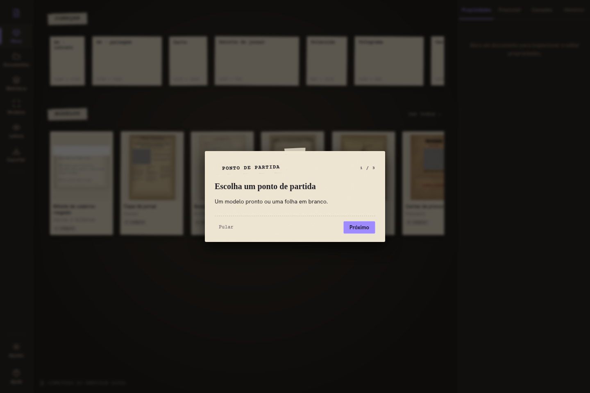

# Ateliê de Documentos

O **Ateliê de Documentos** é um aplicativo dedicado à criação, edição e visualização de documentos imersivos de RPG (*handouts*), como cartas antigas, jornais de época, fichas de investigação, telegramas e fotos polaroides. Ele funciona como uma bancada de artesão digital, permitindo manipular papéis envelhecidos, manchas, carimbos, dobras, fontes de máquina de escrever e camadas secretas que só aparecem sob luz ultravioleta (UV), com leitura em tela cheia e integração direta com o Tabletop.



---

## 📚 Documentação e Guias

- 📖 **[Guia de Uso (docs/USO.md)](docs/USO.md)**: manual completo cobrindo como começar por modelos, aba Preencher, hierarquia de camadas, estilos de tinta, luz UV, modo leitura com lupa e lanterna, exportação em alta resolução (2048 px / 300 ppp) e tabela de atalhos.
- 🛠️ **[Guia de Manutenção e Expansões (docs/MANUTENCAO.md)](docs/MANUTENCAO.md)**: instruções técnicas para desenvolvedores sobre como regenerar a coleção da casa (`npm run colecao:texturas`), orçamento de 60 MB, CLI de importação de elementos e fontes, conversor de modelos PSD e diretrizes de privacidade.
- ⚖️ **[Licenças e Créditos (docs/LICENCAS.md)](docs/LICENCAS.md)**: registro de licenças de tudo o que é distribuído (código sob MIT, acervo público da casa e as 40 famílias de fontes livres sob OFL-1.1 e Apache-2.0).
- 🚀 **[Publicação no GitHub Pages (docs/GITHUB_PAGES.md)](docs/GITHUB_PAGES.md)**: guia para build estático sem servidor (`npm run build:pages`), persistência em IndexedDB, cópia de segurança e integração direta com o Tabletop irmão na mesma origem.
- 📜 **[Contrato de Integração Tabletop (docs/plano/CONTRATO-TABLETOP.md)](docs/plano/CONTRATO-TABLETOP.md)**: especificação técnica dos três caminhos de comunicação entre o Ateliê e o Tabletop (IndexedDB compartilhado, handoff por janela/popup e API REST com CORS).

---

## 🚀 Início Rápido

### Ambiente de Desenvolvimento
```bash
# 1. Instalar dependências
npm install

# 2. Iniciar servidor Express (porta 3011) e interface Vite (porta 5174)
npm run dev
```

Acesse a interface em `http://127.0.0.1:5174` ou o backend em `http://127.0.0.1:3011`.

### Testes
```bash
# Executar todos os testes unitários
npm test

# Executar testes de ponta a ponta (E2E) com Playwright
npm run test:e2e
```

### Build Estático para GitHub Pages
```bash
# Compilar versão estática autônoma para dist-pages/
npm run build:pages

# Testar localmente a versão estática
npm run preview:pages
```

---

## 📦 Acervo e Privacidade

- **Coleção da casa (`public/colecao/`)**: acompanha o aplicativo no Git e é 100% livre. Traz 75 papéis, 53 texturas de acabamento, 294 elementos vetoriais em SVG, 40 famílias de fontes livres e 151 modelos prontos para jogar (132 documentos e 19 variações). O aplicativo é completo e independente sem necessidade de nenhuma expansão.
- **Expansões privadas (`data-private/expansoes/`)**: pacotes opcionais e particulares (como o acervo *Arquivos Confidenciais*) ficam estritamente isolados fora do Git e nunca são incluídos em `public/`, `dist/` ou `dist-pages/`.
