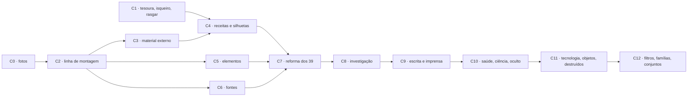

# Plano · Coleção da casa ampliada (de 39 para ~160 modelos) e ferramentas de recorte

Escrito em 26/10/2026 e revisto no mesmo dia, depois que o plano de qualidade de vida (`plano-qualidade-de-vida.md`, Fases 4 a 14) terminou. Segue `00-LEIA-PRIMEIRO.md` e as regras de qualidade da `etapa-16-colecao-modelos.md`, que continuam valendo para cada modelo:
- desenhe o resultado antes de montar;
- textos em português e plausíveis;
- camadas com nome;
- campos claros;
- só itens `casa-`.

Regras de trabalho:
- uma fase por vez;
- cada fase é um commit com teste;
- o `progress.md` é atualizado a cada fase;
- as fases de conteúdo param para o usuário revisar a folha de contato.

**O que mudou na revisão:**
- **Fotos de verdade** viraram a primeira fase (C0). Ela é pequena e não espera a reorganização dos modelos, porque o xadrez cinza é o defeito mais visível.
- **Entrou a Fase C1:** tesoura, isqueiro e rasgar no editor. Ela se inspira no Quadro Investigativo, de Victor "Harden" Saldanha. As silhuetas da coleção (C4) passam a usar o mesmo mecanismo das ferramentas.
- **A C12 (antiga C10) foi detalhada** sobre o código que já existe: `filter-bar.js`, abas e tutoriais.
- As demais fases foram renumeradas em +2.

## Por que

A coleção da casa tem 39 modelos em 8 categorias, e todos se parecem. As medidas abaixo comparam os modelos da casa com os 32 modelos convertidos da expansão (AC = Arquivos Confidenciais).

| Medida | Casa | AC | O que isso mostra |
|---|---|---|---|
| Camadas por modelo | 8 (máx. 19) | 20 (máx. 73) | o AC empilha material, sujeira, objetos e anotações |
| Mesclagens não normais | 12 % | 55 % (multiply, linear-burn, soft-light, screen) | o papel do AC tem profundidade; o da casa é chapado |
| Efeitos procedurais (`effect`) | **1 camada** em 39 modelos | — | o motor de efeitos da etapa 11 quase não é usado |
| Campos por modelo | 3 | 10 | os formulários do AC são densos e críveis |
| Camadas só UV | 1 | 10 | |
| Campos de foto | `src: null` em 8 modelos (aparece um **xadrez cinza**) | fotos reais | é o defeito mais visível na galeria |
| Contorno | retângulo em quase todos | recortes rasgados e queimados, caderno com espiral, pergaminho com hastes, crachá, livro aberto, monitor | o AC trata documento como **objeto** |
| Paleta | quase tudo ofício creme e pergaminho | planta azul, cartão de Natal, identidade verde, madeira escura, tela de celular | |

O que o AC faz bem, e que vamos alcançar **sem copiar nada**:
1. **Material fotográfico:** papel escaneado com fibra e amassado, com várias camadas de sujeira em mesclagens de escurecer.
2. **Silhueta:** bordas rasgadas, queimadas e recortadas, mais objetos inteiros.
3. **Fotos de verdade** nos campos de imagem.
4. **Densidade:** cabeçalhos, códigos, carimbos, rubricas, notas na margem e muitos campos.
5. **Variedade de cor e de suporte.**
6. **Variações** do mesmo documento: limpo, ensanguentado, molhado, queimado.

Aqui a casa já é melhor e precisa continuar assim: textos em português plausíveis (o AC usa *lorem ipsum*), camadas com nome e campos marcados.

## Decisões do usuário

- **Origem do material:** geradores por código **e** material externo CC0 ou de domínio público. Cada arquivo é registrado com origem, licença e SHA-256. Nada de licença "free for personal use", CC-BY-NC ou "royalty free" de banco de imagens.
- **Escala:** cerca de 160 modelos em 16 categorias, com elementos, papéis e fontes na mesma proporção.
- **Universo:** documentos genéricos de época e algumas **instituições fictícias próprias**, que se repetem e dão coesão aos modelos. Nada de propriedade intelectual alheia; nenhum nome do AC ("Ordo", "C.R.I.S.", "Praga Carmesim" etc.).
- **Fotos no projeto:** sim. Ficam em `public/colecao/` como itens da casa (Fase C0).
- **Bordas rasgadas e queimadas:** são uma **ferramenta do editor**, não só um efeito pronto (Fase C1).

## Limites que não mudam

- A coleção vai para o git e para o site. **Nada** da pasta `data-private/` entra em `public/`, `docs/` ou `scripts/`.
- O teste `tests/privacy.test.js` continua passando.
- As comparações visuais com o AC são feitas **só** em `data-private/` ou na pasta temporária, nunca em `docs/referencias/`.
- O AC serve de **régua de acabamento**, por categoria. Não copie diagramação, texto, imagem nem nome. Olhe o AC, feche, e desenhe o seu.
- O **Quadro Investigativo** é referência de comportamento e de sensação. O código dele é "todos os direitos reservados": **não copie** código, imagem, som nem texto. Observe como a ferramenta se comporta e escreva a sua do zero.
- `public/colecao/` deve caber em **60 MB** (meta da etapa 16; hoje são 20 MB). O orçamento está nas Fases C0 e C3. Se não couber, pare e pergunte ao usuário.
- O app continua completo sem expansão.
- O contrato com o Tabletop (`CONTRATO-TABLETOP.md`) não muda. Ver o item "Tabletop" da Fase C1.

---

## Fase C0 · Fotos de verdade (primeiro)

Esta fase vem antes de tudo e mexe no `scripts/colecao/templates.js` **como ele está hoje**. A divisão em arquivos fica para a C2.

### O que está vazio hoje

São 8 camadas de imagem com `src: null` em `scripts/colecao/templates.js`:

| Linha | Camada | Foto que precisa |
|---|---|---|
| 434 | Imagem do postal | paisagem ou vista de cidade antiga |
| 966 | Foto ilustrativa | cena de rua ou fachada (jornal) |
| 1111 | Foto principal | lugar ou evento (jornal) |
| 1787 | Foto 3x4 do suspeito | retrato de frente, P&B |
| 2912 | Foto do paciente | retrato de estúdio antigo, **não** foto real de paciente |
| 3453 | Desenho do mapa | mapa antigo em domínio público, ou mapa desenhado por código |
| 3562 | Foto do procurado | retrato de frente, antigo |
| 4161 | Foto instantânea | cena ou retrato para a polaroide |

### Buscar e registrar

- **Script `scripts/colecao/externos/fetch.js`** com `scripts/colecao/externos/externos.lock.json`, no mesmo padrão de `scripts/fonts/fetch.js` + `fonts.lock.json`.
  - **Cada entrada:** id `casa-foto-…`, URL do arquivo, página de origem, autor (ou "desconhecido"), licença, URL da página da licença, SHA-256 do original e o recorte `crop: {x, y, w, h}` escolhido à mão.
  - **Fluxo:** baixa para uma pasta de cache fora de `public/` (por exemplo `.cache/externos/`, no `.gitignore`), confere o SHA-256 e trata com `sharp`: recorte, P&B neutro, lado maior de 900 px e WebP com qualidade 80. O resultado vai para `public/colecao/`.
  - **Sem rede:** se o cache existe e o hash confere, roda offline. O build normal **não** baixa nada; só usa o que já está em `public/colecao/`.
- **Fontes aceitas, nesta ordem:**
  1. APIs com CC0 explícito: Smithsonian Open Access, The Met Open Access e Rijksmuseum;
  2. Library of Congress com "No known restrictions on publication";
  3. NYPL Digital Collections com o filtro "public domain";
  4. Wikimedia Commons só com `PD-old-70`, `PD-US-expired` ou `CC0` na página do arquivo.
- **Cuidado com pessoas reais.** Retratos de estúdio com mais de 100 anos, sim. Fichas policiais reais, pacientes de hospício, vítimas e crianças em contexto de crime, **não**: o RPG transformaria uma pessoa real em suspeito ou monstro. Na dúvida, use outro retrato.
- **`docs/LICENCAS.md`** ganha a seção "Material de terceiros (CC0 e domínio público)", gerada a partir do lock, com uma linha por arquivo.

### O que entra

| Grupo | Quantidade | Uso | Orçamento |
|---|---|---|---|
| Retratos de estúdio (1880 a 1950, de frente e de três quartos, homens, mulheres e idosos; nenhuma criança) | 24 | 3×4, procurado, ficha, crachá, obituário | 3 MB |
| Lugares e cenas (ruas, estações, casarões, fábricas, portos, florestas, interiores) | 16 | jornal, postal, polaroide, relatório | 2,5 MB |
| Mapas antigos | 4 | mapa rasgado, carta náutica, mapa tático | 1,5 MB |

Os 8 modelos usam 8 fotos. As outras servem aos modelos novos e à Biblioteca.

### Ligar aos modelos

- Cada uma das 8 camadas passa a `image: { src: { library: 'casa-foto-…' }, fit: 'cover', filter: … }`. O filtro que a camada já tem (sépia, P&B, contraste) continua dando o tom da época, e por isso as fotos são gravadas em P&B neutro.
- Escolha a foto pelo modelo: o 3×4 do suspeito e o procurado são retratos **diferentes**, e a polaroide não repete a foto do jornal.
- O campo continua trocável no Preencher, como hoje.
- **Biblioteca:** entra a categoria nova "Fotografias", com as subcategorias Retratos, Lugares e Mapas, para quem quiser usar as fotos fora dos modelos.

### O xadrez do editor

Hoje `drawLayer` (`src/render/handout-render.js:317-322`) desenha o xadrez em **toda** imagem vazia, também na prévia, no assado, na exportação e no que vai para o Tabletop.

- Crie a opção de render `emptyImage: 'placeholder' | 'none'`, com padrão `'none'`.
- **Só o palco do editor** passa `'placeholder'`. Ele desenha um quadro discreto (fundo `--at-paper` a 8 %, borda tracejada, ícone de foto e "Solte uma foto aqui" em escala), não o xadrez.
- Prévia, assado, exportação, Leitura e envio ao Tabletop não desenham nada no lugar vazio.
- **Auditoria mínima já nesta fase:** um teste em `tests/colecao-templates.test.js` falha se algum modelo da casa tiver camada `image` com `src: null` (a não ser que esteja marcada `allowEmpty: true`).

**Teste:**
- as prévias dos 8 modelos são regeradas, e a folha de contato não tem nenhum xadrez;
- um teste de unidade cobre `emptyImage: 'none'` (pixel transparente) e `'placeholder'`;
- `fetch.js --verify` confere o SHA-256 de todos os arquivos do lock.

**Parada para revisão:** folha de contato dos 8 modelos, antes e depois.

---

## Fase C1 · Tesoura, isqueiro e rasgar

O Quadro Investigativo é uma mesa de jogo ao vivo: lá o papel queima até virar cinza e some. O Ateliê é um editor, e o resultado precisa ser **guardado, editável e desfazível**. Por isso a regra aqui é: **cada gesto vira uma camada de corte**, que aparece em Camadas, pode ser escondida, apagada ou ajustada, e entra no histórico. Do Quadro vem a sensação: chama que tremula, fogo que avança, gesto de arrastar ao longo do papel.

### O que já existe

- `burn` e `tear` são efeitos de corte (`isCutEffect`, `applyCutEffect` em `src/render/handout-render.js:173-206`; máscaras em `src/render/handout-effects.js:253+`). Hoje eles só sabem cortar as **bordas da caixa inteira** (queimar as 4 bordas, rasgar um lado).
- A camada de corte apaga **tudo o que está abaixo dela** (`destination-in` no canvas da página, linhas 410 e 429). Se estiver **presa a uma camada** (grupo de recorte, linha 458), apaga só aquela camada. Isso já dá os dois usos: cortar a folha ou cortar só uma foto.
- O assado (`src/editor/bake.js`) grava PNG com alfa, então a folha recortada chega transparente ao Tabletop.
- O pincel (`src/editor/draw-tools.js`, `src/domain/brush.js`, `src/render/handout-path.js`) já captura traços com pressão e normaliza pontos para a caixa da camada (`normalizeStroke`, `thinPoints`, `MAX_PATH_POINTS`). As ferramentas novas usam o mesmo caminho.

### Modelo de dados

Um tipo novo de efeito de corte: `effect.type: 'cut'`. Ele entra em `isCutEffect`. O formato vive em `src/domain/handouts.js` (fábrica e validação), ao lado dos efeitos atuais:

```js
effect: {
  type: 'cut',
  edge: 'tesoura' | 'picote' | 'rasgado' | 'queimado',
  // um ou mais contornos fechados, em coordenadas 0–1 da caixa da camada;
  // a área DENTRO dos contornos é removida
  remove: [[[x, y], …], …],
  // furos de queima: trilha do isqueiro, com raio em px da página por ponto
  holes: [[[x, y, r], …], …],
  seed,            // aspereza da borda, fibras, chamuscado
  char: 0–1,       // largura da faixa tostada em volta do corte (queimado)
  fiber: 0–1,      // fibra branca na borda (rasgado)
}
```

- A camada de corte tem a caixa da página (ou da camada a que está presa). Os pontos são normalizados, então mover ou redimensionar a camada move o corte junto, como no pincel.
- **Limites na validação:** soma de pontos ≤ `MAX_PATH_POINTS`, raio ≤ metade da página e `seed` inteiro.
- **Render** (`src/render/handout-effects.js`, função nova `drawFreeCutMask`):
  - pinta a máscara branca;
  - recorta os contornos de `remove`;
  - para `holes`, desenha círculos ao longo da trilha com raio variável, unidos e com borda irregular pelo ruído com semente (`scripts/colecao/noise.js` já tem um ruído; use ou porte o de `handout-effects.js`).
  - **Bordas:**
    - `tesoura`: corte limpo com uma ondulação leve (mão humana, ±0,6 px);
    - `picote`: zigue-zague regular (tesoura de picotar);
    - `rasgado`: deslocamento por ruído em duas escalas e uma faixa de fibra clara de 1–3 px, desenhada **por cima** do papel restante (a fibra do papel rasgado é mais clara que a superfície);
    - `queimado`: gradiente da borda para dentro (preto → marrom → tostado), em multiply sobre o papel restante, mais pontos de brasa só na hora do gesto (ver "Animação").
  - Entra no cache de máscaras que já existe (`type, seed, amount, params, W, H, scale`), com um hash dos pontos.
- **Os efeitos antigos** `burn` e `tear` continuam como estão, para não mudar documentos já salvos.

### Ferramentas

Elas entram na barra de ferramentas da Fase 11 (`TOOLS` em `draw-tools.js`), com ícones novos em `icons.js` e atalhos registrados no `keymap.js`. As letras X, Q e T estão livres no escopo do editor; confira com `conflicts()` antes de fixar.

| Ferramenta | Atalho | Gesto | Resultado |
|---|---|---|---|
| **Tesoura** | X | **arrastar uma linha** que entra e sai da folha (ou da camada selecionada); a folha se divide em duas partes, a menor escurece e fica tracejada, e **um clique** escolhe a parte que sai (Enter aceita a sugerida, Esc cancela) | contorno da parte removida em `remove`, `edge: 'tesoura'` |
| | Alt | **laço**: o traço fecha sozinho; remove o que está **fora** (recortar uma foto de revista, letras de bilhete de ameaça) | `remove` = retângulo da caixa menos o laço |
| | Shift | troca para `picote` | |
| **Rasgar** | T | **arrastar** de uma borda à outra, como no "rasgue aqui" do Quadro. Quanto mais rápido o gesto, mais irregular a borda. Depois é igual à tesoura: clique na parte que sai | `edge: 'rasgado'`, `fiber` pela velocidade |
| | Alt | **canto arrancado**: arrastar perto de um canto tira um pedaço triangular irregular | |
| **Isqueiro** | Q | **segurar e passar** a chama. Parado, o furo **cresce** com o tempo (o fogo avança, até um raio máximo); andando, deixa uma trilha queimada. Começar fora da folha queima **a partir da borda** | `holes`, `edge: 'queimado'`, `char` da faixa de opções |

- **Um gesto por camada.** Cada gesto cria uma camada "Corte · tesoura", "Rasgo" ou "Queimado". Com Shift no início do isqueiro, a trilha é **acrescentada** à camada de queima selecionada, como no pincel.
- **Alvo do corte:**
  - com uma camada de imagem, forma ou texto selecionada, o corte é preso a ela e só ela é cortada;
  - sem seleção, a camada de corte vai **para o topo** e corta a folha inteira.
  - A faixa de opções mostra o alvo ("Cortando: Foto 3×4" ou "Cortando: a folha") e permite trocar.
- **Faixa de opções** (a mesma da Fase 11):
  - Tesoura: picote liga ou desliga.
  - Rasgar: aspereza.
  - Isqueiro: tamanho da chama, velocidade do fogo e largura do tostado.
- **Editar depois:** em Propriedades, a camada de corte mostra borda, aspereza (`seed` com botão "Outra variação"), tostado e fibra. Ocultar a camada desfaz o corte visualmente, sem perder nada.
- **Leitura e Tabletop:** a folha recortada é transparente fora do papel. No editor e na Leitura, a sombra da folha (Fase 13) passa a seguir o **alfa** (`filter: drop-shadow` no canvas, em vez de `box-shadow` na caixa) para o contorno rasgado ter sombra de verdade.
- **Tabletop:** o contrato manda imagens assadas e não muda. Confira, no Tabletop, que uma folha PNG com alfa aparece sem fundo branco. Se aparecer com fundo, **pare e pergunte**, porque mudar isso mexe nos dois lados.

### Animação e som (o que dá a sensação)

Tudo some com `body.reduce-motion` e `prefers-reduced-motion`: o corte é aplicado direto, sem chama nem partículas.

- **Isqueiro:**
  - o cursor é um isqueiro desenhado em SVG, com uma chama em canvas sobreposto (`.stage-tool-overlay`);
  - a chama fica sempre de pé, tremula (ruído no topo e na largura) e se inclina para o lado contrário do movimento, como no Quadro;
  - **luz quente:** enquanto a chama está acesa, um gradiente radial laranja em `screen` sobre a mesa acompanha o cursor. Reaproveite o feixe da lanterna de `src/ui/ambient.js`, mas com cor e tremor próprios, e desligue-o ao soltar;
  - **fogo que avança:** no canvas sobreposto, a borda do furo brilha com brasas (pontos laranja que se apagam em 0,6 s) e sobe uma fumaça fina (10–20 partículas, `--eco-slow`). Ao soltar, as brasas se apagam e só fica a camada.
- **Tesoura:** enquanto arrasta, a linha tracejada segue o cursor e uma tesoura pequena vai junto, inclinada na direção do corte. Ao escolher a parte, ela desliza 12 px para fora e some em fade (`--eco-mid`).
- **Rasgar:** a parte que sai gira 2–4° e cai alguns pixels antes de sumir.
- **Sons novos** em `src/ui/sound.js`, sintetizados como os atuais (nada de arquivo de áudio):
  - `scissors`: estalos curtos a cada ~40 px de arraste;
  - `paper-tear`: ruído filtrado com duração pela velocidade (há um `synthTapeTear` para partir);
  - `lighter`: pederneira (clique metálico + chiado) ao acender;
  - `burn`: crepitar em laço enquanto a chama está sobre o papel, desligado ao soltar.

### Desempenho

- Durante o gesto, o corte é desenhado **só no canvas sobreposto** (uma prévia escura por cima). A camada nasce no `pointerup`. O render completo acontece uma vez.
- O isqueiro guarda a trilha com `thinPoints` (distância mínima de 2 px) e para de crescer no raio máximo.
- Meta: o gesto a 60 fps no A4 de 15 camadas de `tests/e2e/perf.test.js`.

### Tutorial

Uma lição nova em `src/tutorial/lessons.js`, "Rasgar, cortar e queimar":
1. rasgar o topo de um bilhete;
2. recortar uma foto com o laço;
3. queimar um canto;
4. ocultar a camada de queima e mostrar que nada foi perdido.

Ela entra no relatório de cobertura.

### Testes

- **Unidade:**
  - validação de `effect.type: 'cut'` (limites, pontos 0–1);
  - divisão da folha por uma linha (função pura `splitByLine(box, line)`, que devolve os dois polígonos e a área de cada um);
  - laço → `remove` invertido;
  - máscara: pixel dentro do corte com alfa 0 e fora com alfa 255;
  - determinismo pela semente.
- **E2E** (`tests/e2e/cut-tools.test.js`):
  - rasgar a folha e clicar na parte de cima: pixel do canto superior transparente, camada "Rasgo" em Camadas, Ctrl+Z desfaz;
  - laço numa foto selecionada: só a foto é cortada, o papel embaixo continua;
  - isqueiro parado por 1 s faz um furo maior do que por 0,3 s;
  - com reduce-motion, nenhum canvas de partículas aparece.
- **`perf.test.js`:** um documento com 3 camadas de corte continua abrindo em menos de 400 ms.

### C1b · Ajustes depois do primeiro uso (revisão do usuário)

A C1 foi entregue e usada. Cinco pontos saíram da prática e entram no plano **antes da C2**. Cada um vira um commit com teste.

**1. Tesoura e rasgar seguem o gesto, não uma reta.**
- **Hoje:** `finishLine` em `src/editor/cut-tools.js` descarta o traçado e usa só a corda do ponto inicial ao final, em `splitByLine`. O corte sai sempre reto, e o rasgo só ganha irregularidade do ruído da borda. Isso tira a dinâmica do gesto.
- **Novo:**
  - função pura `splitByPath(box, path)` em `src/domain/cut.js`: pega o traçado (pontos do arraste, já com `thinPoints`), **prolonga as pontas** pela tangente até a borda da caixa e devolve as duas partes como polígonos, com as áreas. Traçado que cruza a si mesmo: use só até o primeiro cruzamento.
  - o traçado é **suavizado** (Chaikin, 2 passos) para a tesoura, e **mantém os tremores** para o rasgo; o ruído de `roughenPolygon` entra por cima, como hoje.
  - a linha de prévia (tracejada) e a escolha da parte usam o traçado, não a reta.
  - Shift continua trocando a tesoura para picote. **Alt+Shift** durante o arraste trava o gesto em linha reta (para quem quer reta de propósito).
  - `remove` já aceita contornos com qualquer número de pontos, então **o formato do documento não muda**.
- **Teste:** unidade de `splitByPath` (traçado em S e em arco divide a folha, áreas somam o total, prolongamento chega às bordas, traçado em laço fecha no primeiro cruzamento); E2E que arrasta uma curva e confere que o contorno gravado em `remove` tem mais de 2 pontos fora da reta.

**2. O isqueiro não queima onde não há papel.**
- **Causa:** o gesto nasce em qualquer ponto da página, e a trilha é desenhada em `holes` sem olhar o que existe embaixo. A faixa tostada (`drawCutOverlay`) é pintada na caixa da camada inteira e só apaga a área removida **da própria camada**. Onde outra camada de corte (ou uma queima anterior) já tirou o papel, a faixa aparece sobre o vazio e parece queimar a mesa.
- **Correção:**
  - **no render:** a sobreposição de um corte passa a ser composta **só sobre o que já tem papel** (`source-atop` sobre o canvas da página), nunca sobre alfa 0. Vale para tostado e fibra de qualquer corte, e para camadas presas a uma camada.
  - **no gesto:** ao começar, testa o alfa do documento renderizado no ponto (o editor já tem o canvas do palco). Alfa 0 → o gesto não começa, sem som, sem chama e sem luz quente. Durante a trilha, pontos sobre alfa 0 não entram em `holes`.
  - **na criação:** se nenhum ponto da trilha ficou sobre papel, **nenhuma camada** é criada.
  - **na prévia:** o furo escuro e o aro de brasa só aparecem sobre papel; a chama e a luz continuam seguindo o cursor.
- **Teste:** E2E: queimar um canto, queimar de novo o mesmo lugar (nenhuma camada nova, nenhum pixel mudado fora do papel); pixel da mesa na prévia e no assado não muda; recorte de uma queimadura vizinha não ganha faixa sobre o vazio.

**3. Fluidez do isqueiro (e dos cortes).**
- **Causas prováveis** (medir antes de mexer): a cada quadro `lighterFrame` chama `setup()` (que redimensiona e limpa o canvas inteiro), recalcula `holePolygons` de **toda** a trilha (até 700 discos de 26 pontos) e preenche tudo de novo; a luz quente é um `div` de 440 px com `mix-blend-mode: screen`, que força recomposição a cada movimento; as brasas e a fumaça são recriadas por quadro; no `pointerup` o documento é renderizado com a máscara cheia (bordas com até 5 000 pontos).
- **Plano:**
  1. **medir:** `tests/e2e/perf.test.js` ganha um gesto de isqueiro de 2 s sobre o A4 de 15 camadas, com tempo médio e máximo por quadro (meta: média < 8 ms, máximo < 20 ms, como o arraste de camadas);
  2. **desenho incremental:** o canvas sobreposto guarda o que já foi desenhado e cada quadro acrescenta só os **discos novos** (e a chama); a trilha inteira só é redesenhada ao mudar o zoom;
  3. **resolução da prévia:** o canvas sobreposto usa no máximo 1× de `devicePixelRatio` e sem tamanho da página inteira durante o gesto (apenas a caixa do alvo);
  4. **luz quente barata:** gradiente em uma camada própria promovida (`will-change: transform`), 220 px, movida só por `transform`, sem `mix-blend-mode` no caminho quente (a cor já é aditiva); desligada se o quadro passar de 20 ms;
  5. **partículas com orçamento:** no máximo 60 brasas e 8 fumaças, em *pool* (sem criar objetos por quadro);
  6. **render final:** no `pointerup`, a máscara do corte usa o passo de subdivisão adaptado ao tamanho (já há `perimeter / 5000`; baixar para 2 500 na prévia) e o cache de máscara é preenchido **antes** do primeiro quadro completo, em `requestIdleCallback`;
  7. o mesmo cuidado (itens 2 e 3) vale para a linha de prévia da tesoura e do rasgo, agora com traçado.

**4. As letras T, X e Q não podem atrapalhar a escrita.**
- **Relato:** apertar **T** não deixa escrever; troca para a ferramenta de rasgar.
- **Causa a confirmar:** o tratamento de teclas do editor ignora campos (`INPUT`, `TEXTAREA`, `SELECT`, `contentEditable`) em `editor.js`, mas as ferramentas e a edição de texto no palco, o Preencher e a mini-barra são partes diferentes da tela. Reproduzir em cada uma: caixa de texto no palco recém-criada por duplo clique, campo do Preencher, nome do documento, busca da Biblioteca e campos da mini-barra. Verificar também o foco logo depois de criar o texto (o `textarea` ainda não recebeu o foco e a tecla cai no `window`).
- **Correção:**
  - função única `isTypingTarget(element)` em `src/ui/keymap.js` (campos, `textarea`, `contentEditable`, `[role=textbox]`, e o `textarea` do palco **mesmo antes de receber o foco**, pela marca `data-editing` no palco enquanto a edição está aberta); **todos** os tratadores de atalho usam essa função;
  - as ferramentas de uma letra só valem com o palco em foco; **com um texto em edição, nenhuma letra é atalho**;
  - as ferramentas ganham, além da letra, o **alternador pela barra** (já existe) e a dica "T: rasgar" na `title` do botão, para o atalho ser descoberto sem acidente.
- **Teste:** E2E que cria um texto por duplo clique e digita "Tarde, queimado. Xícara." em seguida (sem esperar), e repete no Preencher, no nome do documento e na busca da Biblioteca; nenhuma ferramenta muda.

**5. B é o pincel.**
- **Hoje:** `B` abre a **Biblioteca** (atalho global do trilho) e o pincel ficou em `Shift+B`, por conflito.
- **Novo:**
  - `tool-brush` passa para **B**, como nos editores de imagem;
  - a Biblioteca passa para **Shift+B** (e o trilho mostra "⇧B" no `data-key`); a Mesa, Documentos e Modelos continuam em `1`, `D` e `M`;
  - quem já tinha personalizado essas duas combinações em `settings.shortcuts` **não é sobrescrito**; se a personalização colidir com a nova combinação, o aviso de conflito da Ajuda aparece na próxima abertura.
- **Atenção:** o texto das lições (`Shift+B` na "Desenhar com o pincel"), a Ajuda, `shortcuts.js`, o teste `tests/shortcuts.test.js` (confere os `data-key` do trilho) e `tests/e2e/draw-tools.test.js` mudam juntos.
- **Teste:** `keymap.test.js` (nenhum par em conflito depois da troca) e E2E: `b` escolhe o pincel e `Shift+B` abre a Biblioteca.

**Ordem:** 4 (escrita) → 5 (B) → 2 (queima só sobre papel) → 3 (fluidez, com a medição do item 2 já no `perf.test.js`) → 1 (traçado livre). O 4 vem primeiro porque bloqueia o uso normal do editor.

---

## Fase C2 · Linha de montagem (sem conteúdo novo)

Hoje `scripts/colecao/templates.js` é um único array de 4 800 linhas, escrito à mão. Isso não escala para 160 modelos.

1. **Dividir:** `scripts/colecao/modelos/<categoria>.js`, cada um exportando um array de especificações. O `templates.js` vira só o pipeline: validar, gravar, renderizar a prévia com Playwright e montar o manifesto. Ele já faz isso nas linhas ~4560-4819.
2. **Kit de construção** (`scripts/colecao/kit.js`): funções puras que devolvem camadas com nome em português. Exemplos:
   - `paper(id, page)`, `aging(preset, {seed})`, `silhouette(kind, {seed})` (Fase C4);
   - `letterhead(org, {x, y, width})`, que monta o timbre de uma instituição do universo;
   - `formField(label, value, box, {font, line:true})`, com rótulo impresso, linha e valor à máquina ou à mão;
   - `photo(slot, {default, frame:'cantoneiras'|'clipe'|'grampo'|'polaroide', tilt})`, em que `default` aponta para uma foto da C0;
   - `signature(name, box, {font})` e `initials(...)`;
   - `stamp(id, {x, y, rot, opacity})`, com rotação de ±4° automática pela semente;
   - `marginNote(text, box)`, `barcode(code, box)`, `tape(corner)`, `clip(edge)`.

   O texto de exemplo vem do universo (item 3), nunca inventado na hora.
3. **Universo** (`scripts/colecao/universo.js`): instituições, pessoas, lugares e datas por época, para os modelos conversarem entre si.
   - O ponto de partida é o que já existe nos modelos: Delegacia de Investigações Especiais, Sanatório da Serra do Mar, *A Gazeta Metropolitana*, Solar dos Pinhais, Companhia Marítima e Comercial do Atlântico, Instituto Médico Legal do Estado.
   - Instituições novas a criar:
     - **Departamento de Ocorrências Extraordinárias** (órgão federal discreto, de 1938 a hoje);
     - **Instituto Halden de Biologia Experimental** (laboratório privado, anos 50 a 80);
     - **Irmandade da Lua Tríplice** (culto, que amarra os sigilos que já existem, como o "chifre da lua tríplice");
     - **Colégio Estadual Visconde de Mauá**;
     - **Cartório do 2º Ofício de Notas de Vila Aurora**;
     - **Rádio e Televisão Atalaia**;
     - **Banco Comercial do Planalto**.
   - Cada instituição tem nome, sigla, endereço, emblema (Fase C5), fontes e paleta próprias, épocas e um elenco de 4 a 6 pessoas recorrentes. As pessoas do elenco ganham um retrato fixo da C0, para a mesma pessoa ter o mesmo rosto em documentos diferentes.
4. **Auditoria automática** (`scripts/colecao/audit.js` e testes em `tests/colecao-templates.test.js`, ampliando o teste da C0). Falha o build quando:
   - um campo de imagem não tem foto padrão (exceto os marcados `allowEmpty`);
   - um modelo A4/carta tem menos de 10 camadas, ou nenhuma camada de envelhecimento (uma textura em mesclagem de escurecer ou uma camada `effect`);
   - um texto **transborda** ou encolhe abaixo de 14 px (usar o layout puro de `src/domain/handout-text-layout.js`);
   - o contraste entre texto e papel fica abaixo de 3:1 (amostrar a cor média do papel atrás da caixa);
   - aparece *lorem ipsum*, nome do AC ou texto em inglês fora do contexto;
   - a fonte não é coerente com a época declarada (tabela `font → épocas` no `universo.js`; isso gera aviso, não erro);
   - um formulário tem menos de 4 campos;
   - o tamanho total de `public/colecao/` passa do orçamento.
5. **Folhas de contato por categoria:** `docs/referencias/colecao-modelos-<categoria>.png`, com `contact-sheet.js` já existente.
   - Comparação particular: o script `scripts/colecao/compare-private.js` põe lado a lado as prévias da casa e as do AC da categoria correspondente. A saída vai para `data-private/expansoes/arquivos-confidenciais/reports/comparacao/`. Ele **recusa** gravar fora de `data-private`, e um teste cobre isso.
6. **Tags e época** no manifesto: `era: '1890'|'1920'|'1950'|'1980'|'hoje'|'medieval'`, `tom: 'investigação'|'horror'|'fantasia'|'cotidiano'|'sci-fi'`, `tags` e `org`. Isso alimenta os filtros da Fase C12.

**Teste:** os 39 modelos atuais, migrados para os arquivos novos, geram prévias **idênticas** (diferença de pixel 0) às prévias que saíram da C0, antes de qualquer outra mudança visual.

## Fase C3 · Resto do material externo

O mesmo `externos/fetch.js` e o mesmo lock da C0, agora para papéis e texturas:

| Grupo | Quantidade | Uso | Orçamento |
|---|---|---|---|
| Papéis escaneados (fibra, amassado, envelhecido, pautado, papelão, cartolina, papel de arroz) | 20 | base fotográfica dos papéis e das texturas de sobreposição | 12 MB |
| Mais fotos (cenas, interiores, objetos), se os lotes pedirem | até 20 | modelos novos | 3 MB |
| Superfícies para composições (madeira, metal, couro, papelão; a cortiça e o feltro procedurais da Fase 13 servem de base e podem bastar) | até 8 | quadro de investigação, mesa, carta de taverna | 4 MB |
| Microtexturas (poeira, riscos, granulação de filme, meio-tom de jornal) | 10 | sobreposições finas | 2 MB |

**Orçamento total:** 20 MB hoje + 7 MB da C0 + 21 MB aqui + 4 MB de fontes (C6) + 6 MB de prévias novas = cerca de **58 MB**.

Fontes recomendadas para papéis e texturas: ambientCG e Poly Haven (CC0).

## Fase C4 · Receitas de envelhecimento e silhuetas

1. **Papéis fotográficos.** O `papers.js` passa a compor o papel procedural **sobre** um escaneamento CC0, com fibra, amassado e variação de luz. Os 16 papéis × 3 idades continuam com os mesmos ids. Entram papéis novos:
   - papel de planta azul (cianotipia);
   - papel de arroz;
   - papelão;
   - papel de fax térmico (desbotado);
   - papel de formulário contínuo (com furos laterais);
   - papel almaço de prova;
   - papel de embrulho;
   - papel timbrado bancário (guilhochê gerado por código);
   - papel de recibo térmico.
2. **Receitas** em `kit.js`: `aging(preset, {seed, intensity})` devolve uma pilha de camadas com nome, mesclagem e opacidade já calibradas. Usa as texturas da casa, os efeitos da etapa 11 (`crumple`, `fold`, `stain`, `damp`, `fade`, `blood`, `grain`) e o corte da C1.

| Receita | Camadas |
|---|---|
| `novo` | grão fino (soft-light, 0,15) |
| `usado` | amassado leve (multiply), 1 dobra, poeira, borda escurecida (`fade`) |
| `antigo` | `crumple` médio, 2 dobras, manchas de idade (linear-burn), bordas amareladas, foxing |
| `arquivo-morto` | `antigo` + umidade num canto, carimbo de arquivo, furos de grampo |
| `queimado` | corte `queimado` (C1) num canto ou na base, fuligem, papel tostado |
| `molhado` | `damp` + tinta escorrida (texto com `wear` alto) + ondulação |
| `ensanguentado` | `blood` (respingo, digital, arrasto) em multiply, com semente |
| `destruido` | cortes `rasgado` em 2–3 bordas, amassado forte, fita segurando |

3. **Silhuetas** em `silhouette(kind, {seed})`:
   - `rasgado-topo`, `rasgado-bordas`, `queimado`, `recorte-tesoura`, `picote`, `deckle`, `canto-arrancado`, `meia-folha`;
   - cada uma gera **uma camada `cut` da C1**: o gerador cria os contornos por código, com semente. O resultado é o mesmo que a pessoa faria à mão com a tesoura, o rasgar ou o isqueiro, e pode ser editado do mesmo jeito.
   - Confira que a prévia, o assado e a Leitura respeitam o alfa. A C1 já garante a sombra pelo contorno.
4. **Teste de unidade:** cada receita e cada silhueta é determinística pela semente e só usa itens `casa-`.

## Fase C5 · Elementos novos (cerca de 140, em SVG e raster)

Os geradores ficam em `scripts/colecao/vectors/` (mesmo padrão de `stamps.js`, `seals.js` etc.). SVG com sombreado (gradientes e ruído `feTurbulence`) para não parecer clip-art.

| Categoria nova | Itens (exemplos) | Qtd. |
|---|---|---|
| **Objetos** | espiral de caderno (topo e lateral), argolas de fichário, prancheta (base e prendedor), crachá com cordão, hastes de pergaminho, lombada de livro, capa de dossiê, pasta suspensa, envelope pardo com cordão, etiqueta de fita VHS, fita cassete | 25 |
| **Interfaces** | moldura de celular (Android e iPhone genéricos, claro e escuro), barra de status, balões de chat, janela de e-mail, janela de sistema retrô (anos 90), terminal com moldura de monitor CRT, monitor moderno, notificação | 18 |
| **Códigos** | código de barras (fonte Libre Barcode na C6), gerador de QR, numeração de série, guilhochê, microtexto, marca d'água | 12 |
| **Postal** | selos postais fictícios (8 épocas), carimbos de correio com data, etiquetas "VIA AÉREA", "REGISTRADO" e "DEVOLVER" | 16 |
| **Emblemas do universo** | um emblema para cada instituição da C2 (versão colorida e versão de carimbo) | 16 |
| **Carimbos brasileiros** | RECONHEÇO FIRMA, cartório, PROTOCOLO com data, "CONFERE COM O ORIGINAL", SIGILOSO, CLASSIFICADO-RESERVADO, carimbo de médico com CRM fictício | 14 |
| **Rabiscos à mão** | setas, círculos, riscos, desenhos de margem, mapas rabiscados, contagem de dias (palitinhos), "NÃO CONFIE", rostos riscados | 25 |
| **Marcas de investigação** | barbante vermelho (segmentos), alfinetes coloridos, post-its, etiquetas numeradas de cena de crime, régua forense | 14 |

As **Interfaces** são também a base dos modelos de Tecnologia. Os textos ficam em camadas de texto por cima, nunca dentro do SVG.

Os selos postais, as etiquetas e os post-its saem com o contorno certo no próprio SVG; recortes irregulares em elementos raster usam a camada `cut` da C1 no modelo, não um arquivo novo.

## Fase C6 · Fontes (+14 famílias)

Todas do `google/fonts`, OFL ou Apache, pelo mesmo `scripts/fonts/fetch.js` com lock, registradas em `LICENCAS.md`:

| Uso | Famílias |
|---|---|
| Letra à mão variada | Shadows Into Light, Indie Flower, Gloria Hallelujah, La Belle Aurore, Mrs Saint Delafield |
| Caligrafia formal | Pinyon Script, Great Vibes |
| Clássica e editorial | EB Garamond, Cinzel |
| Medieval | Uncial Antiqua, Grenze Gotisch |
| Faroeste | Rye |
| Interface moderna (celular e e-mail) | Inter |
| Código de barras | Libre Barcode 39 Text |

A tabela `font → épocas` do `universo.js` cobre todas as fontes. Antes de buscar, confira as categorias de fonte que a Fase 6 de qualidade de vida pôs na aba Fontes da Biblioteca, e encaixe cada família numa delas.

## Fase C7 · Reforma dos 39 modelos atuais

Antes de criar modelos novos, os atuais sobem de nível. Cada um recebe:
- receita de envelhecimento;
- silhueta, quando fizer sentido;
- os campos que faltam, chegando a pelo menos 4 nos formulários;
- timbre de uma instituição do universo.

As fotos já entraram na C0.

Defeitos já visíveis na folha de contato atual:
- faixa branca no "Recorte de jornal · anos 20" e no "Mapa rasgado" (os dois ganham silhueta `cut` em vez da faixa);
- texto pequeno demais e com pouco contraste nos formulários policiais;
- o envelope é chapado.

**Parada para revisão:** folha de contato antes/depois com o usuário.

---

## Fases C8 a C11 · Modelos novos (em 4 lotes)

Cada lote tem cerca de 30 modelos e termina com a folha de contato das suas categorias e uma revisão com o usuário. Fluxo de cada modelo:
1. Olhar a categoria correspondente do AC na comparação particular.
2. Decidir época, tom e instituição.
3. Montar no kit.
4. Rodar a auditoria.
5. Revisar a prévia em tamanho real.

**Variações** ("· ensanguentado", "· queimado", "· UV" etc.) são modelos derivados de uma base por uma receita:
- `variants: [{ suffix, aging, extra }]` na especificação;
- cada variante tem id e prévia próprios e entra como item `template` com `family: <slug da base>`;
- a gaveta Modelos agrupa as variantes no detalhe da base;
- somam cerca de 25 dos 160 e não substituem documentos distintos.

Os tamanhos seguem os papéis (A4 = 1240 × 1754).

### Lote C8 · Investigação e Estado

| Categoria | Modelo | Época | O essencial | Campos |
|---|---|---|---|---|
| Polícia e investigação | Termo de depoimento | 1950 | timbre da Delegacia de Investigações Especiais, cabeçalho de formulário, texto corrido à máquina, rubrica em cada margem | Depoente, Data, Escrivão, Depoimento |
| | Auto de apreensão | 1970 | tabela de itens com numeração, carimbo de protocolo, duas testemunhas | Número, Local, Itens, Testemunhas |
| | Ficha de pessoa desaparecida | 1990 | foto padrão com clipe, dados físicos, cartaz colado com fita | Foto, Nome, Idade, Visto por último |
| | Relatório de vigilância | 1980 | horários em coluna, notas à mão na margem, foto de teleobjetiva granulada | Agente, Alvo, Registro, Fotos |
| | Quadro de investigação | hoje | **composição**: cortiça (C3), fotos, recortes, post-its e barbante vermelho (C5) | Fotos, Notas, Título do caso |
| | Mandado de busca · variação ensanguentada | — | derivado do Mandado atual | — |
| Forense e perícia | Laudo de necropsia | 1960 | silhueta corporal frente e costas com marcações, tabela de órgãos, carimbo do IML | Número, Vítima, Achados, Causa |
| | Cadeia de custódia | 1990 | formulário com faixas de assinatura e datas, código de barras | Item, Número, Transferências |
| | Etiqueta de corpo | 1970 | cartolina com ilhós e barbante, à mão | Nome, Data, Número |
| | Laudo de balística | 1980 | esquema de projétil em formas, medidas, foto de cápsula | Arma, Calibre, Conclusão |
| | Análise de digitais | 1950 | 10 quadros de digitais (casa-digitais), fichas datiloscópicas | Nome, Classificação, Observações |
| | Relatório de cena de crime | hoje | planta baixa em formas, marcadores numerados, legenda | Local, Data, Legenda |
| Oficial e jurídico | Certidão de nascimento | 1920 | livro de registro em almaço, caligrafia formal, selo de cartório | Nome, Pais, Data, Local |
| | Certidão de casamento | 1950 | moldura, selos, duas assinaturas | Cônjuges, Data, Cartório |
| | Carteira de identidade antiga | 1960 | cartão verde dobrado, foto 3×4, digital, guilhochê | Foto, Nome, Filiação, Número |
| | Passaporte · página de dados | 1970 | papel de segurança, carimbos de entrada e saída sobrepostos | Foto, Nome, Carimbos |
| | Testamento | 1900 | manuscrito longo, reconhecimento de firma, lacre | Testador, Texto, Testemunhas |
| | Escritura de imóvel | 1930 | timbre do Cartório de Vila Aurora, texto em parágrafos numerados | Imóvel, Outorgantes, Valor |
| | Procuração | 1980 | formulário de cartório, selo, rubricas | Outorgante, Procurador, Poderes |
| Militar e governo | Ordem de missão · ultrassecreto | 1960 | Departamento de Ocorrências Extraordinárias, tarjas pretas, carimbo SIGILOSO | Código, Agentes, Objetivo |
| | Dossiê de agente | 1970 | capa de dossiê (objeto) com foto e clipe, ficha de serviço | Foto, Nome, Codinome, Histórico |
| | Telegrama militar | 1940 | tiras coladas, código de prioridade, carimbo de censura | Origem, Destino, Mensagem |
| | Mapa tático | 1940 | kraft, quadrícula, setas e marcas à mão, legenda | Mapa, Legenda |
| | Relatório redigido | 1980 | tarjas pretas como formas sobre o texto, carimbo LIBERADO PARCIALMENTE | Texto, Trechos tarjados |
| | Crachá de acesso | hoje | **objeto**: crachá com cordão, foto, código de barras | Foto, Nome, Nível |

### Lote C9 · Papel do dia a dia, escrita e imprensa

| Categoria | Modelo | Época | O essencial | Campos |
|---|---|---|---|---|
| Cadernos, diários e livros | Caderno espiral · página | 1990 | espiral (C5), pauta, letra à mão que **enche** a página, rabiscos | Data, Texto |
| | Diário aberto · página dupla | 1890 | livro aberto (lombada e sombra no meio), duas colunas à mão, flor seca (forma) | Data, Página esquerda, Página direita |
| | Caderneta de bolso | 1950 | formato pequeno com argolas, anotações curtas, números de telefone | Anotações |
| | Livro antigo · página impressa | 1800 | capitular, notas de rodapé, anotações a lápis na margem | Título, Texto, Notas |
| | Agenda de compromissos | 1980 | grade semanal, compromissos riscados, um circulado | Semana, Compromissos |
| | Capa de diário de couro | — | **objeto**: capa de couro (CC0), fecho, etiqueta | Título, Dono |
| Cartas e bilhetes | Carta de amor · perfumada | 1940 | papel de seda, caligrafia formal (Pinyon), mancha de batom (forma) | Destinatário, Texto, Assinatura |
| | Carta de despedida | hoje | folha de caderno amassada, letra trêmula (Gloria Hallelujah) | Texto |
| | Bilhete de ameaça · recortes | 1980 | **letras recortadas** de jornal (cada palavra num bloco de fonte diferente, levemente girado) | Mensagem |
| | Carta em código | 1920 | cifra de substituição numa grade, chave parcial à mão na margem | Texto cifrado, Pista |
| | Cartão de Natal | 1960 | ilustração festiva em vetores, borda vermelha e verde, dedicatória | Ilustração, Dedicatória |
| Jornal e impressos | Página de revista | 1970 | duas colunas, foto grande, título em caixa alta, fólio | Título, Texto, Foto |
| | Panfleto de culto | 1980 | xerox (`fade` + grão), sigilo da Irmandade da Lua Tríplice, convite | Título, Convite, Endereço |
| | Cartaz de desaparecido | 1990 | foto, telefone em tiras de destacar na base | Foto, Nome, Contato |
| | Edição extra | 1930 | manchete enorme, uma coluna, carimbo EXTRA | Manchete, Texto |
| | Anúncio fúnebre | 1950 | tarja preta, cruz, texto centralizado | Nome, Datas, Convite |
| Escola e juventude | Boletim escolar | 1980 | Colégio Visconde de Mauá, tabela de notas, carimbo da secretaria | Aluno, Notas, Observações |
| | Prova corrigida | 1990 | almaço, respostas à mão, correções em vermelho, nota circulada | Aluno, Respostas, Nota |
| | Bilhetinho passado em sala | 1990 | dobrado em quatro (dobras), letra de adolescente, desenhos | Texto |
| | Carteirinha de estudante | 1980 | **objeto** plastificado, foto | Foto, Nome, Série |
| | Página de anuário | 1970 | grade de 3×3 fotos com legendas e uma dedicatória | Fotos, Nomes, Dedicatória |

### Lote C10 · Saúde, ciência, oculto e fantasia

| Categoria | Modelo | Época | O essencial | Campos |
|---|---|---|---|---|
| Médico e sanatório | Atestado médico | 1970 | receituário, letra de médico, carimbo com CRM fictício | Paciente, Dias, Médico |
| | Ficha de triagem do sanatório | 1930 | Sanatório da Serra do Mar, foto de admissão, escalas marcadas com X | Foto, Paciente, Avaliação |
| | Desenho de paciente | 1950 | papel barato com rabiscos perturbadores (C5), anotação clínica em cima | Desenho, Anotação |
| | Prontuário de cirurgia | 1980 | diagrama anatômico, horários, assinaturas da equipe | Paciente, Procedimento, Equipe |
| | Bula / rótulo de remédio | 1920 | rótulo de farmácia antiga, ornamentos | Remédio, Posologia |
| | Exame de sangue | hoje | impresso de laboratório com tabela de referência, um valor destacado | Paciente, Resultados |
| Ciência e laboratório | Relatório de experimento | 1960 | Instituto Halden, seções numeradas, gráfico em formas, foto de laboratório | Experimento, Método, Resultado |
| | Ficha de cobaia | 1970 | foto, tabela diária, observações cada vez mais alarmantes | Foto, Espécie, Registro |
| | Planta de laboratório | 1960 | **planta azul** (papel da C4), linhas brancas, cotas, carimbo de aprovação | Planta, Título, Legenda |
| | Caderno de pesquisa · UV | 1980 | quadriculado, fórmulas, uma página inteira **só na luz UV** | Anotações, Segredo UV |
| | Gráfico de sismógrafo | 1980 | papel contínuo com furos, linha de leitura procedural, anotação à mão | Data, Leitura, Nota |
| | Memorando interno | 1970 | timbre do instituto, "PARA/DE/ASSUNTO", rubricas | Para, De, Assunto, Texto |
| Ocultismo e rituais | Grimório · página dupla | 1600 | livro aberto, ilustração de sigilo, textos em duas colunas, notas posteriores | Título, Texto, Ilustração |
| | Pacto assinado em sangue | 1890 | pergaminho, assinatura em vermelho escuro, lacre preto | Termos, Assinatura |
| | Recorte de livro proibido | 1900 | meia página queimada, tipografia antiga | Texto |
| | Mapa astral | 1920 | círculo zodiacal em formas, anotações | Nome, Data, Leitura |
| | Invocação · UV | hoje | folha comum com uma invocação visível **só sob UV** | Texto visível, Texto UV |
| Medieval e fantasia | Carta náutica | 1500 | pergaminho, rosa dos ventos, rumos, monstros marinhos (ornamentos) | Mapa, Legenda |
| | Contrato de guilda | 1400 | iluminura, cláusulas numeradas, selo pendente | Guilda, Contratado, Cláusulas |
| | Página de bestiário | 1300 | ilustração emoldurada, texto em Uncial | Criatura, Descrição |
| | Recompensa do reino | 1600 | papel tosco pregado (tachas), brasão | Procurado, Recompensa |
| | Carta de taverna | 1500 | cardápio à mão em giz sobre madeira (fundo C3) | Pratos, Preços |

### Lote C11 · Tecnologia, objetos, cotidiano e destruídos

| Categoria | Modelo | Época | O essencial | Campos |
|---|---|---|---|---|
| Tecnologia | Conversa de celular · claro / escuro | hoje | moldura de celular (C5), balões, horários, "digitando…" | Contato, Mensagens |
| | E-mail no celular | hoje | cabeçalho de app de e-mail genérico (Inter) | De, Assunto, Corpo |
| | Tela de computador · anos 90 | 1990 | janela de sistema retrô, ícones, documento aberto | Título, Texto |
| | Monitor moderno | hoje | **composição**: monitor sobre a mesa (madeira), janela de navegador fictícia | Página, Texto |
| | Log de servidor | hoje | terminal com timestamps e um erro em vermelho | Linhas |
| | Transcrição de ligação | 1990 | formulário policial com falas por horário | Interlocutores, Transcrição |
| | Fax recebido | 1990 | papel térmico (C4), cabeçalho de fax, linhas falhadas | Remetente, Texto |
| | Postagem de rede social fictícia | hoje | perfil, foto, curtidas, comentários | Usuário, Foto, Texto |
| Fotografias e objetos | Foto colada com fita | — | foto PD com fita crepe nos cantos, legenda no verso | Foto, Legenda |
| | Porta-retrato | — | moldura de madeira (CC0), vidro com reflexo | Foto |
| | Tira de fotos de cabine | 1960 | 4 fotos em tira, borda branca | Fotos |
| | Negativo de filme | 1970 | tira de negativo laranja (foto invertida por receita) | Fotos |
| | Etiqueta de fita VHS | 1990 | **objeto** fita VHS com etiqueta à mão | Título, Data |
| | Carteira de investigador | 1980 | **objeto** carteira aberta: foto e distintivo | Foto, Nome, Matrícula |
| Cotidiano | Cardápio de restaurante | 1950 | art déco, preços em réis ou cruzeiros conforme a época | Restaurante, Pratos |
| | Lista de compras | hoje | post-it, itens riscados | Itens |
| | Conta de luz | 1980 | formulário com código de barras e consumo em gráfico | Titular, Endereço, Valor |
| | Extrato bancário | 1990 | Banco Comercial do Planalto, tabela de lançamentos, um valor circulado | Titular, Lançamentos |
| | Cheque | 1970 | guilhochê, valor por extenso, assinatura | Valor, Favorecido, Assinatura |
| | Bilhete de cinema | 1950 | picote, número | Filme, Sessão |
| Destruídos e composições | Carta queimada | 1920 | receita `queimado` (corte do isqueiro, C1), metade legível | Texto |
| | Documento molhado | 1980 | receita `molhado`, texto escorrido | Texto |
| | Página rasgada em pedaços | — | 3–4 pedaços remontados com fita: o mesmo papel em camadas separadas, cada uma com um corte `rasgado` (C1) e um ligeiro desalinhamento | Texto |
| | Mesa de investigação | — | **composição**: madeira, pilha de documentos, polaroides, xícara (formas), lupa | Documentos, Fotos |
| | Envelope de evidências | 1990 | envelope pardo lacrado com fita de evidência, etiqueta | Número, Conteúdo |

### Variações (cerca de 25, geradas pelas receitas)

Escolha as bases que fazem sentido narrativo:
- **ensanguentado:** carta, bilhete, diário, ficha criminal, relatório policial, laudo;
- **queimado:** grimório, carta, mapa;
- **molhado:** diário, bilhete;
- **UV:** relatório policial, laudo de necropsia, ficha de cobaia;
- **arquivo-morto:** certidões e dossiê.

A auditoria confere que cada variação difere visivelmente da base (diferença média de pixel acima de um limite).

---

## Fase C12 · Encontrar o que há na coleção

Com 160 modelos, a galeria precisa ajudar a escolher. O plano de qualidade de vida já entregou o necessário para esta fase:
- `src/ui/filter-bar.js` (`createFilterBar`, `activeFilters`), usado em `templates-drawer.js` (grupos montados por volta da linha 250 e entregues em `filterBar.update({ groups })`);
- abas (`openInTab(handout, { newTab, background })` em `editor.js`, `src/editor/tabs.js`);
- tutoriais (`src/tutorial/`).

O trabalho é encaixar dados novos nesses lugares, não criar componentes.

- **Filtros novos** na gaveta Modelos: **Época**, **Tom** e **Instituição**, vindos de `era`, `tom` e `org` (Fase C2). São três grupos a mais no mesmo `filterGroups`, com contagem e "+N mais" como os atuais.
- **Famílias de variações:** a grade mostra só a base; o detalhe do modelo (`templates-drawer.js`) mostra as variações (`family`) em miniaturas clicáveis, com o mesmo `.tab-crossfade` ao trocar.
- **Conjuntos** ("Caso do Sanatório da Serra do Mar", "Arquivos do Instituto Halden", "Dossiê da Lua Tríplice"):
  - cada um reúne de 4 a 6 modelos da mesma instituição, com nomes, datas e rostos (C2) que combinam entre si;
  - novo item `kind: 'set'` no manifesto, com `templates: [ids]`; a busca e os filtros tratam o conjunto como um card próprio;
  - "Usar conjunto" chama `openInTab` para cada modelo: o primeiro com `newTab: true`, os outros com `background: true`. A aba ativa fica no primeiro.
- **Tela inicial** (`src/editor/start.js`): "Modelos em destaque" alterna por semana (semente = número da semana) e ganha uma fileira "Novidades" (os itens com `addedIn` mais recente no manifesto).
- **Busca:** cobre `tags`, `era`, `org` e o texto de exemplo dos campos.
- **Tutoriais:** as lições que hoje abrem um modelo da casa passam a abrir um modelo novo, quando houver um que ensine melhor (por exemplo, a lição de UV com "Invocação · UV"). Rode o relatório de cobertura.
- **Teste e2e:** filtrar por Época 1920 e Tom horror mostra só modelos coerentes; "Usar conjunto" abre N abas; a família mostra as variações no detalhe.

## Ordem



- **C0 primeiro.** É pequena e acaba com o xadrez.
- **C1 é do editor**, não da coleção. Pode ser feita logo depois da C0, ou em paralelo com a C2, mas precisa estar pronta antes da C4, porque as silhuetas usam a camada `cut`.
- C3, C5 e C6 podem andar em paralelo depois da C2.
- A C12 não depende mais de nada fora deste plano: o plano de qualidade de vida terminou.

## Riscos

- **Tamanho do site:** fotos e escaneamentos pesam. A auditoria mede a cada build. Se o total passar de 60 MB, reduza a resolução (lado maior de 1600 px nos papéis, 900 px nos retratos) antes de cortar conteúdo, e só então pergunte.
- **Licença errada:** só entra arquivo com licença explícita CC0 ou PD na página de origem. "Sem restrições conhecidas" da LoC conta; marcações ambíguas, não. O lock guarda a URL da página da licença.
- **Pessoas reais nas fotos:** ver a regra da C0. Ninguém real como suspeito, paciente ou vítima.
- **Ferramenta que destrói:** a C1 nunca apaga pixel de outra camada. Se um gesto não virar camada desfazível, ele está errado.
- **Corte e alfa no Tabletop:** se a folha recortada chegar com fundo branco, a correção mexe no contrato. Pare e pergunte.
- **Desempenho do isqueiro:** máscaras com muitos furos podem pesar. O cache por hash dos pontos e o limite de `MAX_PATH_POINTS` seguram isso; se um documento com cortes passar de 400 ms ao abrir, rasterize a máscara uma vez por escala.
- **Uniformidade:** 160 modelos feitos pelo mesmo kit podem ficar iguais. Exija em cada lote pelo menos 3 suportes diferentes (papel, objeto, tela) e 3 paletas diferentes por categoria. A folha de contato por categoria mostra o problema.
- **Desempenho dos modelos:** modelos com 30 ou mais camadas e efeitos procedurais precisam abrir em menos de 400 ms. Rode `tests/e2e/perf.test.js` com o modelo mais pesado de cada lote.
- **Prévias grandes:** mantenha o lado maior em 480 px e WebP com qualidade 80.

## Como validar o conjunto

- A folha de contato completa não tem nenhum xadrez cinza, nenhuma faixa branca e nenhum modelo "chapado" (todos com envelhecimento visível).
- Uma pessoa rasga o topo de uma carta, recorta uma foto e queima um canto em menos de um minuto, sem ler ajuda, e desfaz tudo com Ctrl+Z.
- Lado a lado com o AC na comparação particular, cada categoria da casa tem acabamento equivalente sem nada copiado. O usuário confirma.
- `npm test`, `npm run test:e2e`, a auditoria e `tests/privacy.test.js` passam.
- O tamanho de `public/colecao/` está dentro do orçamento, e o `docs/LICENCAS.md` lista cada arquivo de terceiros.
- Uma pessoa encontra "um documento policial dos anos 50 manchado de sangue" em até três cliques de filtro.
