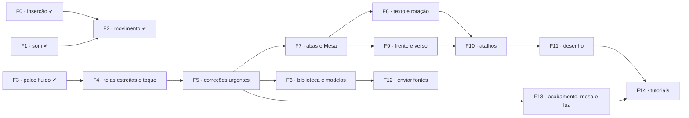

# Plano · Qualidade de vida, fluidez, ambientação e responsividade do Ateliê

Escrito em 25/10/2026, com as etapas 1 a 27 e a 29 concluídas (a 28 é no Tabletop). **Revisto em 26/10/2026** para incorporar o lote de correções e pedidos que o usuário relatou depois das Fases 0 a 3 (ver "Levantamento de 26/10"). Segue as regras de `docs/plano/00-LEIA-PRIMEIRO.md`: uma fase por vez, cada uma é um commit com teste, e o `progress.md` é atualizado. Toda fase com interface segue o `PLANO-INTERFACE.md`, usa os tokens `--at-*`/`--eco-*`, tem textos em pt-BR e respeita `body.reduce-motion` e `prefers-reduced-motion` (exemplo em JS: `layers-panel.js:398`).

## Situação das fases

| Fase | Tema | Situação |
|---|---|---|
| 0 | Camadas entram onde se espera | concluída |
| 1 | Sons da bancada | concluída |
| 2 | Movimento e retorno visual | concluída (o fantasma da biblioteca está quebrado: refeito na Fase 6) |
| 3 | Palco fluido (desempenho) | concluída (com regressão: o fundo some no arraste, corrigida na Fase 5) |
| 4 | Telas estreitas e toque | concluída |
| 5 | Correções urgentes | concluída |
| 6 | Biblioteca e Modelos | concluída |
| 7 | Abas de documentos e Mesa como início | concluída |
| 8 | Texto, mini-barra e rotação | concluída |
| 9 | Frente e verso no editor | concluída |
| 10 | Atalhos configuráveis e de quem edita muito | concluída |
| 11 | Ferramentas de desenho | concluída |
| 12 | Enviar fontes próprias | concluída |
| 13 | Acabamento visual, superfícies da bancada e ambientação de luz | concluída (era a Fase 6) |
| 14 | Tutoriais interativos | concluída (era a Fase 7) |

A antiga Fase 5 ("Atalhos de quem edita muito") foi distribuída: os itens de texto e seleção foram para a Fase 8, "Usados recentemente" para a Fase 6, e o resto para a Fase 10.

## O que o levantamento achou (25/10)

| Achado | Onde | Tipo |
|---|---|---|
| **Um asset adicionado da biblioteca vai para o fundo da pilha.** O motivo é um bug, não falta de recurso: `addLayer(handout, layer, index)` recebe o **id** da camada selecionada, e não a posição dela. `Math.min(len, 'abc')` dá `NaN`, e `splice(NaN)` insere na posição 0. Sem nada selecionado, `null` vira 0, e o asset também vai para o fundo. | [editor.js:1174](file:///home/ilvro/Documents/Projects/Atelie/src/editor/editor.js#L1174), [library-panel.js:176](file:///home/ilvro/Documents/Projects/Atelie/src/editor/library-panel.js#L176) e [:229](file:///home/ilvro/Documents/Projects/Atelie/src/editor/library-panel.js#L229) | bug |
| **Arraste em meia resolução** (§7 do PLANO-INTERFACE: "arrastar a 60 qps; renderize a meia resolução e refaça ao soltar") não existe. Cada `pointermove` refaz o documento inteiro em resolução total. | `stage.js` `performRender` | prometido, não feito |
| **Telas estreitas** (§5: "< 1100 px o inspetor vira gaveta; < 720 px só Preencher e Leitura") não existem. Nenhum `@media (max-width…)` no CSS. | `src/ui/*.css` | prometido, não feito |
| **Movimento da §4**: só o carimbo ARQUIVADO, o brilho UV, o levantar da miniatura e a troca na Leitura existem. Faltam a folha entrando ao abrir, a troca de documento no editor e o aviso caindo com rotação. | `styles.css`, `editor.css` | prometido, em parte |
| **Ambientação da mesa e iluminação**: o palco do editor (`.stage-viewport`) usa fundos escuros genéricos sem a textura tátil de bancada prometida. Não há textura de cortiça investigativa, e falta um controle rápido de iluminação (luminária, vela, lanterna de inspeção móvel, luz de estúdio) para testar os documentos em diferentes climas de mesa de jogo. | `stage.js`, `settings.js`, `primitives.css` | novo |
| Não há nenhum som no app. | — | novo |
| O plano de tutoriais de outra conversa (`plano-tutoriais-interativos.md`) usa um modelo de dados que não existe (`handout.pages`, `layer.type`, `state.uvLampActive`) e controles inventados ("Camada Oculta (Luz UV)", margens de corte, preset A5, máscara de borda rasgada). Ele também não traz as lições do `PLANO_TUTORIAIS.md` do Tabletop: passos "agora sozinho", ajuda em degraus, o retorno "quase lá" e o "?" em cada tarefa. | brain de outra conversa | corrigir |


## Levantamento de 26/10

Relato do usuário depois das Fases 0 a 3, com a causa encontrada no código. Vários sintomas vêm de **uma só causa**: o modal de confirmação não tem CSS e fica invisível.

| Relato | Causa encontrada | Fase |
|---|---|---|
| Clicar num documento em Documentos não abre | `confirmUnsavedChanges` e `showDraftPrompt` (`editor.js:509-578`) criam `.at-modal-backdrop`, que **não tem CSS nenhum**. O modal vai para o fim do `body` (`overflow:hidden`) e fica fora da tela. Acontece com documento `dirty` ou com rascunho. | 5 |
| "Usar este modelo" não faz nada com documento aberto | A mesma do item acima (`editor.js:863-876`) | 5 |
| Ajustes sem rolagem | `.at-settings-card` sem `max-height`, `.at-settings-body` sem `overflow-y` (`styles.css:663-708`) | 5 |
| Esc não sai da Leitura | Em tela cheia o navegador consome o Esc; não há listener de `fullscreenchange` (`reading.js:615-693`) | 5 |
| O fundo do modelo some ao arrastar texto | Regressão da Fase 3: o cache de arraste é montado com `loadedImages: new Map()` (`stage.js:462-475`, `534`, `547`), e o papel vira xadrez | 5 |
| Com zoom alto, o arraste com botão direito/meio para antes da borda | `.stage-scroll-canvas` centraliza a página e o transbordo à esquerda e acima não é rolável (`editor.css:4-32`) | 5 |
| Não aparece rotação perto das pontas | A alça existe, mas `.stage-rotate-handle` não tem `position:absolute` (`editor.css:191`) e fica sob a alça `nw`; não há zona de rotação nos cantos | 5 e 8 |
| Desligar a luz UV não anima | As `transition` só existem em `html[data-light="uv"] …` (`editor.css:2644-2664`); o gradiente da madeira volta na hora; o canvas não faz crossfade | 5 |
| Cubo em "Voltar para modelos" | `arrow-left` não existe em `icons.js`; o fallback é `room` (um cubo) | 5 |
| Lixeira sem contagem | `navigator.js:93-105` só lista a lixeira quando o filtro está ativo | 5 |
| "Mesa" não volta à tela inicial | Com documento aberto, `editor.js:899-907` só reage a Ctrl+clique; a ação `desk` da paleta cai num callback vazio (`main.js:22-24`) | 5 e 7 |
| Filtros ruins em Modelos e Biblioteca | Chips em linha com rolagem horizontal (`start.css:493-543`, `controls.css:437-492`); Fontes sem filtro de categoria | 6 |
| Arrastar da Biblioteca mostra o card com texto, não o elemento no tamanho real | Sem `setDragImage`; o fantasma usa `thumbUrl`/`thumbnail` (não existem), tamanho fixo `0.45 × página` e `opacity:.55` (`editor.js:1159-1243`) | 6 |
| Recolher/expandir na Biblioteca joga o scroll para o topo | `render()` refaz tudo com `innerHTML` (`library-panel.js:443`) | 6 |
| Abrir item na Biblioteca não tem animação | Nenhuma transição em grupos, prévia nem detalhe de modelo | 6 |
| "Abrir em nova aba" abre aba do navegador | `window.open` (`navigator.js:371`); o editor só tem um documento por vez (`editor.js:47-53`, `loadHandout` 635-782) | 7 |
| Sem cor de texto, fonte ou destaque | Cor e fonte **existem** em Propriedades (`properties-panel.js:476-543`), mas o editor abre em Preencher e nunca troca de aba. Destaque não existe no modelo. | 8 |
| Não dá para virar frente e verso | O verso é outro documento ligado por `handout.back` (`handouts.js:234`); só a Leitura vira (`reading.js:356-400`) | 9 |
| Ajuda sem atalhos configuráveis | `shortcuts.js` é só uma tabela; cada arquivo testa `e.key` fixo | 10 |
| Ferramenta de pintura ou desenho | Não existe; só formas pelo menu "+" | 11 |
| Enviar fonte do computador | Não existe; o caminho das expansões no navegador (`expansion-installer.js`) já carrega fontes por `FontFace` | 12 |

Decisões do usuário (26/10): desenho = **pincel e formas desenhadas arrastando**; verso = **virar, criar verso e desvincular**; Mesa = **aba de início que não fecha os documentos**.

---

## Fase 0 · Camadas entram onde se espera · concluída

**Regra de inserção** (uma função pura nova em `src/domain/handouts.js`, usada em **todos** os pontos que criam camada: biblioteca, colar, arrastar arquivo, menu "+", efeitos, texto, forma):

```js
/** Where a new layer goes: papers at the bottom; anything else right above the selection, or on top when nothing is selected. */
export function insertionIndex(handout, layer, { selectedId = null, role = 'auto' } = {})
```

- `role: 'paper'` (itens da categoria Papéis e `defaults.cover`) vai para cima da camada de papel mais alta que já existir. Assim, trocar de papel não esconde nada.
- Os outros vão logo acima da camada selecionada. Sem seleção, vão para o **topo**.
- `addLayer` passa a aceitar **apenas** número e a lançar erro se receber outra coisa. O bug não volta calado.
- Depois de inserir: a camada fica selecionada, a lista de camadas rola até ela e a linha pisca uma vez (`--eco-mid`).

Testes:
- unidade: `insertionIndex` para papel, sangue com e sem seleção, e `addLayer` rejeitando string;
- E2E: arrastar "Sangue · gotas múltiplas" para um modelo com 10 camadas deixa a camada nova em `layers.at(-1)` e à vista no pixel.

---

## Fase 1 · Sons da bancada (desligáveis) · concluída

**`src/ui/sound.js`**: sons **sintetizados com Web Audio**, sem arquivo nenhum. Ruído filtrado, envelopes curtos e uma pequena variação aleatória de altura e volume a cada toque, para não soar repetitivo. Isso dá zero bytes e nenhuma licença a registrar. Se um som sintetizado não convencer, a alternativa é um `.ogg` CC0 em `public/colecao/sons/`, registrado em `docs/LICENCAS.md`.

| Momento | Som |
|---|---|
| Digitar numa camada de texto (edição no lugar e campo de texto do Preencher) | depende da fonte: **Máquina de escrever**: tecla, espaço mais grave, sininho e carro no Enter; **Letra à mão / Marcador**: risco de lápis curto; **Tela de computador**: clique de teclado e bipe baixo no Enter; as outras: tecla macia |
| Soltar um carimbo, selo ou lacre na página | batida seca (o lacre ganha um "chiado" de cera) |
| Fita crepe | fita rasgando |
| Abrir ou trocar documento, virar o verso | papel deslizando |
| Ligar e desligar a luz UV | clique de interruptor e zumbido baixo enquanto está ligada (só se "Ambiente" estiver ligado) |
| Alternar iluminação (luminária / lanterna / vela) | clique mecânico de botão, click de lanterna de metal ou fósforo acendendo |
| Arquivar | carimbo ARQUIVADO |
| Excluir camada / desfazer | amassar curto / sem som |

Regras:
- O contexto de áudio só é criado depois do primeiro gesto da pessoa (a política dos navegadores exige isso).
- O som fica mudo com a aba escondida, e as teclas são limitadas a no máximo 1 som a cada 35 ms, para que segurar uma tecla não vire metralhadora.
- Tudo passa por `play(name, { variant })`. O editor não sabe sintetizar nada.

**Ajustes da Mesa → Som**:
- `sound: { enabled, volume (0–100), typing: 'auto' | 'typewriter' | 'pen' | 'off', ambient }`;
- uma linha "Ouvir exemplo" ao lado de cada opção.

Testes:
- unidade: mapear fonte → voz de digitação; limitar os toques; `enabled: false` não cria `AudioContext`;
- E2E: com o som ligado, digitar 5 letras chama `play('type')` 5 vezes (espião em `window.__atelie.sound`); com ele desligado, nenhuma vez.

---

## Fase 2 · Movimento e retorno visual · concluída

Só `transform` e `opacity`, os tokens `--eco-*` e nada com `prefers-reduced-motion` ou `body.reduce-motion`.

1. **Completar a §4:**
   - a folha entra de baixo 24 px, girada 2°, ao abrir;
   - ao trocar de documento, ela sai pela esquerda e a nova entra pela direita;
   - o aviso cai do canto com rotação.
2. **Camada nova "pousa" na página:** um contorno aparece por cima da camada em escala 1,06 → 1, com a sombra baixando (`--eco-fast`). Em seguida vem o som da Fase 1.
3. **Lista de camadas com FLIP:** reordenar, subir, descer, agrupar e excluir animam a posição das linhas em vez de saltar.
4. **Excluir com desfazer à mão:** o aviso "Camada excluída · **Desfazer**" fica 5 s na tela. O mesmo vale para "Documento movido para a lixeira".
5. **Arrastar da biblioteca** *(feito de forma incompleta: o fantasma mostra o nome em vez do elemento, com tamanho e opacidade errados; refeito na Fase 6)*: um "fantasma" semitransparente do item segue o cursor sobre a página, já no tamanho e na mesclagem que vai ter (`defaultsFor`). A pessoa vê onde vai cair antes de soltar.
6. **Gavetas e inspetor:** abrir e fechar com deslizamento, e trocar de aba com um cruzamento curto de opacidade.
7. **Sliders e números:** a roda do mouse sobre o campo ajusta o valor (Shift dá passo ×10), e o valor aparece num balão durante o arraste.

Teste E2E: com redução de movimento ligada, nenhuma animação passa de 0 ms (o mesmo `getAnimations()` usado em `shell.test.js`).

---

## Fase 3 · Palco fluido (desempenho) · concluída

> [!WARNING]
> O cache de três camadas foi montado sem as imagens carregadas, e o papel some durante o arraste. A correção está na Fase 5, item 4.

Metas da §7, medidas por teste: abrir um A4 com 15 camadas em menos de 400 ms; arrastar a 60 quadros por segundo.

1. **Três camadas de cache durante o arraste:** ao começar a mover a camada *k*, componha uma vez o "abaixo de *k*" e o "acima de *k*" em bitmaps. Cada quadro passa a desenhar só 3 coisas. Ao soltar, refaça o documento inteiro.

   > [!NOTE]
   > Uma camada com mesclagem não normal acima de *k* depende do que está embaixo. Nesse caso o cache de "acima" não vale, e o arraste cai para o item 2.

2. **Meia resolução no arraste** (e no zoom com a roda), refeita em resolução total 150 ms depois do último movimento.
3. **Cache dos efeitos procedurais** por `(tipo, parâmetros, semente, tamanho)`: ruído e desgaste não são recalculados a cada quadro.
4. **Layout de texto memorizado** por `(conteúdo, fonte, caixa)`: mexer na posição não refaz a quebra de linhas.
5. **Assar e exportar fora da thread principal** com `OffscreenCanvas` num Worker, quando o navegador permitir (com recuo para a thread principal). Arquivar não trava mais a interface.

Testes:
- `tests/e2e/perf.test.js` mede abrir o A4 de 15 camadas e 60 eventos de arraste, com o tempo médio por quadro abaixo de 16,7 ms numa máquina de referência; os números vão para o `progress.md`;
- um teste de pixel confere que o resultado final depois de soltar é **idêntico** ao render normal.

---

## Fase 4 · Telas estreitas e toque · concluída

Cumpre a §5:
- **< 1100 px:** o inspetor vira gaveta pela direita, com botão na barra do documento.
- **< 720 px:** a tela de início, o **Preencher** e a **Leitura** ficam completos; o editor mostra só "Propriedades simples" (texto, fonte, cor, posição).
- **Toque** (`pointer: coarse`):
  - pinça para zoom e dois dedos para mover a mesa;
  - alças de transformação de 24 px;
  - pressionar longo abre o menu de contexto.
- **Container queries** nos painéis do inspetor: os controles se reorganizam pela largura do painel, não da janela.

Teste E2E em 3 viewports (1600 × 950, 1024 × 768, 390 × 844): nada sobra para fora da tela (`scrollWidth ≤ clientWidth`); Preencher e Leitura funcionam a 390 px. As capturas de referência vão para `docs/referencias/`.

> [!NOTE]
> Concluída e commitada antes da Fase 5 (61772af): inspetor em gaveta abaixo de 1100 px, pinça e toque longo, alças de 24 px e container queries.

---

## Fase 5 · Correções urgentes · concluída

São bugs que travam fluxos básicos. Cada item é pequeno.

1. **O modal de confirmação está invisível.**
   - **Correção:** criar em `src/ui/styles.css` as regras de `.at-modal-backdrop`, `.at-modal`, `.at-modal-header` e `.at-modal-body`:
     - fundo com `position:fixed; inset:0`, escurecido, e `z-index` acima das gavetas e dos outros modais (>450, porque `.at-conversion-modal` usa 450);
     - cartão centralizado, com o visual de `.at-settings-card`, e entrada curta.
   - Esc ou clique no fundo cancela. O foco vai para o botão principal.
   - O mesmo modal é usado em `editor.js:509-578`, `properties-panel.js:240` e `fill-panel.js:207`.
   - **Teste:** `tests/e2e/editor.test.js:211` passa a exigir que o modal esteja **visível** dentro da viewport (hoje só confere se ele existe no DOM).
2. **Ajustes sem rolagem:** `.at-settings-card { max-height: calc(100dvh - 32px); display:flex; flex-direction:column }` e `.at-settings-body { flex:1; min-height:0; overflow-y:auto }`.
3. **Esc na Leitura:**
   - em `open()`, registrar `fullscreenchange`: se não houver `document.fullscreenElement` com o leitor aberto, chamar `close()`;
   - remover o listener em `close()`;
   - `close()` não chama `exitFullscreen` quando já não há tela cheia.
4. **O fundo some no arraste** (regressão da Fase 3):
   - `renderHandout` (`handout-render.js:522-556`) devolve o `loadedImages` que montou, ou aceita um Map de fora;
   - o `stage.js` guarda o último (`lastLoadedImages`) a cada `performRender` e usa esse Map em todas as chamadas síncronas do arraste;
   - não trocar o `<canvas>` (`stage.js:215-220`) durante um gesto;
   - sob luz UV, não fatiar por `kIdx` (isso ignora a ordem UV e o escurecimento): fazer `renderHandoutSync` completo.
   - **Teste e2e:** arrastar um texto num modelo com papel mantém a cor do papel num pixel de canto.
5. **Pan com zoom alto:**
   - `.stage-scroll-canvas { flex: 1 0 auto; width:max-content; min-width:100%; min-height:100% }`, sem `align-items/justify-content:center`, e `.stage-page-wrap { margin:auto }`;
   - Ctrl+roda (`stage.js:747-764`) e `setZoom` ancoram o zoom no ponto sob o cursor, ou no centro.
   - **Teste:** com zoom 4×, `scrollLeft=0` mostra a borda esquerda da página.
6. **Alça de rotação:** `position:absolute` em `.stage-rotate-handle`. A zona de rotação nos cantos vem na Fase 8.
7. **Ícone de seta:**
   - criar `'arrow-left': '<path d="M19 12H5m6-6-6 6 6 6"/>'` em `icons.js`;
   - remover o `eye` duplicado;
   - em dev, `console.warn` para nome de ícone inexistente.
8. **Lixeira (n):**
   - `loadData()` do `navigator.js` sempre busca `api.trash.list()` e guarda `trashCount`;
   - o chip mostra `Lixeira (34)`, ou só "Lixeira" com zero;
   - a contagem é atualizada ao excluir, restaurar e apagar de vez.
9. **Ação `desk` da paleta:** ligar o callback de `main.js:22-24` ao mesmo `notifyAction` do trilho. O comportamento novo da Mesa vem na Fase 7.
10. **Desligar a luz UV anima como ligar.** A Fase 13 reaproveita o mesmo mecanismo para os outros modos de luz.
    - Mover as `transition` para os seletores base: `.desk-doc-bar`, `.at-btn.is-primary`, `.inspector-tab.active`, `.rail-btn.active` e o botão UV `[aria-pressed]`.
    - Mesa: em vez de zerar `background-image`, usar `.at-desk::after` com o tom UV e animar a `opacity`.
    - Canvas: em `stage.show` (`stage.js:247-270`), quando a luz muda, copiar o canvas atual para um canvas sobreposto e esmaecê-lo depois do novo render. Pular isso com reduce-motion.
    - Carimbo UV: classe com fade no lugar de `display`.

---

## Fase 6 · Biblioteca e Modelos · concluída

1. **O scroll não pula mais:**
   - helper `preserveScroll(scrollEl, anchorEl, fn)`: guarda o `top` do cabeçalho clicado, roda o render e corrige `scrollTop`;
   - usar ao recolher e expandir, favoritar, "Mostrar mais", "Recolher tudo" e nos chips;
   - Modelos guarda o `scrollTop` da grade antes do detalhe e o restaura em "Voltar".
2. **Animação ao abrir:**
   - o grupo recém-aberto ganha `.is-opening` (keyframe `library-expand`: opacity e translateY de −4 px, em `--eco-mid`);
   - a seta ▸/▾ vira um chevron SVG que gira;
   - `.library-hover-preview` ganha fade e escala;
   - o detalhe de modelo (`templates-drawer.js:98`) reaproveita `.tab-crossfade` (`styles.css:384-397`).
3. **Filtros sem rolagem horizontal:**
   - **Componente comum** `src/ui/filter-bar.js`:
     - grupos com rótulo ("Origem", "Categoria") e chips que **quebram linha**, com contagem "(n)";
     - grupos longos mostram 2 linhas e o chip "+N mais", que expande com animação;
     - linha de filtros ativos com "Limpar filtros";
     - a origem vira um seletor segmentado, que só aparece com mais de uma origem.
   - **Modelos** (`templates-drawer.js:229-355`): usar o componente e remover a conversão da roda em `scrollLeft`.
   - **Biblioteca** (`library-panel.js:259-327`):
     - usar o componente;
     - cabeçalho de filtros `sticky`;
     - **filtro de categoria também em Fontes** (os dados já têm 8 categorias);
     - contagem por categoria.
   - **Teste e2e:** nenhum contêiner de filtro com `scrollWidth > clientWidth`.
4. **Arrastar na escala real e com opacidade total** (corrige o item 5 da Fase 2):
   - **Função pura `libraryDropSize(item, page)`**:
     - usada pelo fantasma, pelo drop (`editor.js:1245-1325`) e pelo clique (`library-panel.js:125-149`);
     - calcula `min(item.width, page.width*0.5)` mantendo a proporção, ou a página inteira com `defaults.cover`;
     - hoje drop e clique dão tamanhos diferentes.
   - **No `dragstart`** (`library-panel.js:586-603`): `setDragImage` com uma imagem 1×1 transparente, para o navegador não desenhar o card.
   - **O fantasma:**
     - é um `` real, com `api.library.previewURL(item)`, ou `resolvePreviewURL`/`resolveFileURL` para expansões;
     - mede `libraryDropSize × stage.getZoom()`, com `opacity:1` e sem borda tracejada;
     - fica centrado no cursor;
     - fica em `position:fixed` no `body`, para seguir o cursor desde a gaveta;
     - é removido em `dragend` ou `drop`;
     - `item.name` é escapado.
5. **"Usados recentemente"** (da antiga Fase 5): primeira fileira da Biblioteca, com 12 itens, guardada em `localStorage`.

---

## Fase 7 · Abas de documentos e Mesa como início · concluída

Vários documentos abertos ao mesmo tempo, em abas dentro do app, como no Photoshop.

- **Novo `src/editor/tabs.js`:**
  - `sessions: Map<id, { state, hasDraft, draftSaved, draftTimer, isReadOnly, light, view:{zoom, scrollLeft, scrollTop} }>`;
  - `activeId`, em que `null` é a Mesa;
  - a ordem das abas fica em `localStorage['atelie-tabs']` e é restaurada no `init()`.
- **Refatorar `editor.js`:**
  - `loadHandout` (635-782) se divide em duas funções:
    - `openInTab(handout, {newTab})`;
    - `activateTab(id)`: salva o `view` da aba que sai, religa os painéis do inspetor com o `state` da sessão e o `stage`, e restaura zoom, scroll, luz, `?handout=` e `atelie-last`.
  - O rascunho é checado só na primeira abertura.
  - As variáveis soltas (`state`, `hasDraft`, `draftSaved`, `draftTimer`, `isReadOnly`, `currentLight`, em 47-53, 224 e 250-255) passam a ler da sessão ativa. Um getter `current()` facilita a migração.
  - O timer de rascunho fica por sessão (`draft.js` já indexa por id).
  - O `check-open` do BroadcastChannel (285-304, 763-769) considera todas as sessões. `tests/e2e/tabs.test.js` continua passando.
- **Fechar aba** (×, botão do meio ou Ctrl+W): pede confirmação só se aquela aba estiver suja e depois ativa a vizinha ou a Mesa.
- **Barra de abas** acima da `.desk-doc-bar`:
  - cada aba mostra o título, um ponto de "não salvo" e o ×; dá para arrastar e reordenar;
  - a primeira aba é a Mesa, fixa;
  - com muitas abas, aparecem setas de rolagem;
  - Ctrl+Tab e Ctrl+Shift+Tab alternam entre as abas.
- **Documentos** (`navigator.js`):
  - o clique ativa a aba, se o documento já estiver aberto;
  - senão, substitui a aba ativa (com confirmação, se ela estiver suja), ou abre uma nova quando a ativa é a Mesa;
  - "Abrir em nova aba", botão do meio e Ctrl+clique chamam `onOpenInTab(id, {newTab:true})`, sem `window.open`.
- **Modelos:** "Usar este modelo" abre numa aba nova, sem confirmação.
- **Mesa** (`editor.js:899-907`, `showStartScreen` 140-157):
  - mostra a tela inicial (`start.js`) com `activeId=null`, **sem fechar as sessões**;
  - "Continuar" lista primeiro as abas abertas;
  - o Ctrl+clique antigo deixa de existir, e `app:start` faz o mesmo que a Mesa.
- **Testes e2e:**
  - com 2 documentos, editar o 1º, trocar e voltar mantém a edição e o histórico;
  - a Mesa mostra o início e as abas continuam lá;
  - fechar uma aba suja pede confirmação;
  - recarregar a página restaura as abas.

---

## Fase 8 · Texto, mini-barra e rotação · concluída

1. **Mini-barra de texto** (`selection-bar.js`). Com uma camada de texto selecionada, mostra:
   - família (com `mountFontSelector` de `font-selector.js` num popover);
   - tamanho, peso, itálico e alinhamento;
   - **cor**, **destaque** e "Mais…" (abre Propriedades).
   - Tudo passa pelo caminho de `applyFieldChange` (`properties-panel.js:103-230`), para entrar no histórico.
   - A mini-barra já tem duplicar, ordem, mesclagem, travar e excluir; isso cobre o item da antiga Fase 5.
2. **Destaque:** campo opcional `text.highlight: null | { color, opacity, padding }`.
   - Onde mexer:
     - `textLayer()` (`handouts.js:119-141`);
     - validação (602-632);
     - `drawTextLayer` (`handout-text.js:111-178`): um `fillRect` por linha antes do `fillText`; entra na chave de memoização;
     - campo também em Propriedades.
   - Confira `CONTRATO-TABLETOP.md`: o campo não pode quebrar documentos antigos.
   - **Testes de unidade:** validação e pixel do destaque atrás do texto.
3. **Girar pelos cantos:**
   - quatro `.stage-rotate-zone[data-corner]` de cerca de 24 px fora de cada canto (`stage.js:73-84`), abaixo das alças de redimensionar;
   - cursor SVG de rotação, compensado pela rotação da camada (reaproveitar `getHandleCursor`, `stage.js:21-52`);
   - no `pointerdown`, tratar a zona antes de redimensionar e mover;
   - nova função pura `rotateBoxBy(startRotation, center, startPointer, pointer, {snap})` em `geometry.js`: usa o delta de ângulo, sem o +90° fixo de `rotateBox`; Shift gira em passos de 15°;
   - **teste de unidade.**
4. **Da antiga Fase 5:**
   - um texto novo herda fonte, cor e tamanho do último texto editado no documento;
   - clique duplo em área vazia da página cria um texto ali;
   - Alt+clique alterna entre as camadas empilhadas sob o cursor.

---

## Fase 9 · Frente e verso no editor · concluída

O verso é um documento separado, ligado pela frente: `handout.back = { handoutId }`.

- **"Virar":**
  - botão na `.desk-doc-bar`, mais a tecla F, que vira atalho na Fase 10;
  - abre o verso **na mesma aba**: a sessão guarda o par e a face ativa;
  - a animação gira `.stage-page-wrap` em `rotateY` em duas metades, trocando a face no meio (referência: `.reader-face`/`is-flipped` do `reader.css`);
  - toca o som de papel;
  - a aba ganha "· verso" no nome.
- **"Criar verso"**, para documentos sem verso:
  - novo documento com o mesmo `page` e só as camadas de papel da base;
  - liga os dois lados e salva ambos.
- **"Desvincular verso":** remove `back` dos dois lados.
- **Verso apagado:** um aviso oferece desvincular.
- **Teste e2e:** criar o verso, virar, editar o verso e voltar.

---

## Fase 10 · Atalhos configuráveis e de quem edita muito · concluída

- **Novo `src/ui/keymap.js`:**
  - padrões vêm de `SHORTCUTS` (`shortcuts.js`), e as trocas do usuário ficam em `getSettings().shortcuts`;
  - `saveSettings` (`settings.js:63-80`) mescla `shortcuts` como já faz com `sound`;
  - API: `matches(event, id)`, `label(id)`, `set`, `reset` e `conflicts(combo, scope)`;
  - combos normalizados (Meta equivale a Ctrl no Mac);
  - escopos `global`, `editor` e `reading`.
- **Migrar os `e.key` fixos** para `keymap.matches`:
  - `shell.js:275-340`, `editor.js:1532-1697`, `reading.js:556-594` e `palette.js:202-207`;
  - Espaço e Esc em `stage.js`.
  - A navegação local de listas continua fixa.
- **Testes:** `tests/shortcuts.test.js` passa a validar pelo registro, e não por tokens no texto do arquivo.
- **Ajuda** (`help.js:10-31`):
  - cada linha ganha "Alterar", que captura a próxima combinação e avisa se ela já estiver em uso no mesmo escopo;
  - "Restaurar padrão" para um atalho e para todos;
  - a tabela usa `keymap.label(id)`.
- **Atalhos novos:** Ctrl+W, Ctrl+Tab e F (virar), além das ferramentas da Fase 11.
- **Da antiga Fase 5:**
  - **Esc em cascata:** sai da edição de texto, depois tira a seleção, depois fecha a gaveta;
  - **variação ao duplicar** (Ctrl+Shift+D): cópia deslocada, girada ±4°, com semente nova em efeitos;
  - **carimbos entram tortos**, ±3°, o que se pode desligar nos Ajustes.

---

## Fase 11 · Ferramentas de desenho · concluída

- **Ferramenta ativa** no `stage.js`: `activeTool: 'select' | 'brush' | 'rect' | 'ellipse' | 'line'`.
  - Uma barra vertical na lateral esquerda da mesa mostra as ferramentas.
  - Atalhos pelo keymap: V, B, R, O e L. Antes, confira conflitos (Shift+R já existe).
  - Esc volta a `select`.
- **Formas por arraste:** o arraste cria uma camada `shape` (`rect`, `ellipse` ou `line`, em `handout-render.js:241-275`) com o box do gesto.
  - Shift trava em 1:1, ou em ângulos de 45° na linha.
  - Usa a cor atual.
- **Pincel:** novo `shape.type: 'path'`.
  - Dados:
    - `points: [[x,y,p], …]`, **normalizados de 0 a 1 no box da camada**, para que mover, redimensionar e girar funcionem sem código novo;
    - `stroke`, `width` e `opacity`.
  - Render:
    - suavização por pontos médios e curvas quadráticas;
    - largura × `PointerEvent.pressure` (0.5 no mouse).
  - Gesto:
    - durante o traço, desenha num canvas sobreposto;
    - no `pointerup`, calcula o box, normaliza os pontos e cria uma camada por traço;
    - Shift no começo acrescenta o traço à camada de pincel selecionada.
  - Validação com no máximo 20 000 pontos.
- **Faixa de opções** sobre a mesa enquanto a ferramenta está ativa: cor, espessura e opacidade.
- **Testes:**
  - unidade: validação de path e normalização;
  - e2e: um traço cria a camada e pinta o pixel.

---

## Fase 12 · Enviar fontes próprias · concluída

- **Botão "Enviar fonte"** na aba Fontes da Biblioteca:
  - aceita `.ttf`, `.otf`, `.woff` e `.woff2`;
  - valida com `new FontFace(nome, arrayBuffer).load()`; se falhar, mostra um aviso em bilhete;
  - um diálogo curto deixa editar o nome da família (sugerido pelo nome do arquivo), o peso e o itálico.
- **Guardar como "expansão do usuário"** no banco de expansões do navegador (`expansion-installer.js`):
  - o item é `{ kind:'font', id:'usuario-font-…', family, weight, style, category:'Minhas fontes', file, source:'usuario' }`;
  - depois, invalidar `browserManifestPromise` e chamar `window.__atelie.refreshLibrary()`;
  - lista, seletor e `FontFace` (`handout-fonts.js`) funcionam sem mudar o renderizador.
- **Modo servidor:** `handout-fonts.js:11-17` passa só o id a `resolveFileURL`, e `serverLibrary.resolveFileURL` (`api.js:1060-1067`) só consulta o IndexedDB quando recebe um objeto com `source`. Passe o item, ou desvie os ids `usuario-`.
- **"Remover fonte"** no menu de contexto, só para `source:'usuario'`.
- **Backup:** incluir essas fontes em `backup.js`, se ele ainda não cobrir as expansões do navegador.
- **Teste e2e:** enviar um `.woff2`, ver o card e aplicar a fonte num texto.

---

## Fase 13 · Acabamento visual, superfícies da bancada e ambientação de luz · concluída

1. **Superfícies procedurais completas no palco da mesa:**
   - O palco do editor (`.stage-viewport` e `.stage-scroll-canvas`) passa a renderizar visivelmente a textura da bancada selecionada, em vez de fundos planos escuros.
   - **Nova textura: Cortiça Investigativa (`cortica`)**: granulação procedural clara/escura com relevo e furos sutis de alfinete (clássico de quadros de investigação policial e RPGs de mistério).
   - Aprimoramento das texturas existentes em `primitives.css` e `settings.js`: **Madeira escura envernizada**, **Feltro verde de alfaiate/jogos**, **Couro**, **Concreto / Ardósia forense** e **Preto neutro**.
   - As texturas são 100% procedurais (SVG inline / gradientes CSS), com zero carregamento de arquivos externos.

2. **Modos de Iluminação e Ambientação rápida:**
   - Adição de um botão rápido com menu de iluminação no topo do palco (ou atalho de teclado) para inspecionar o documento em diferentes climas:
     - **Luminária de Bancada** (padrão): foco central suave sobre o documento com calor ajustável (quente/neutro) e penumbra discreta na borda da mesa.
     - **À Luz de Velas (`vela`)**: luz âmbar/alaranjada quente com uma leve e sutil tremulação orgânica na vinheta da mesa (respeita `prefers-reduced-motion`).
     - **Lanterna Móvel de Inspeção (`lanterna`)**: o ambiente escurece e um feixe circular de lanterna segue a posição do cursor do mouse, permitindo inspecionar detalhes, desgastes e caligrafias minuciosas (`Shift + roda` ajusta a abertura do feixe).
     - **Luz Negra / UV (`uv`)**: integra a iluminação UV da Etapa 19, escurecendo a sala em tom violeta profundo e ativando o brilho das tintas fluorescentes e marcas d'água.
     - **Luz Plana de Estúdio (`estudio`)**: iluminação clara, uniforme e sem sombras na mesa, ideal para alinhamento geométrico e conferência de contraste estrito.

3. **Sombra e profundidade da folha:**
   - Sombra projetada da folha proporcional ao zoom e responsiva à direção e ao modo de luz ativo.
   - Leve reflexo da luminária sobre a mesa na direção do documento.

4. **Acabamentos de interface:**
   - **Miniatura real na linha da camada** (render da camada sozinha, 40 px, em cache por revisão), no lugar do ícone genérico por tipo.
   - **Esqueleto de carregamento** na Biblioteca e nos Modelos (retângulos de papel pulsando de leve), em vez de a área aparecer vazia.
   - **Estados vazios** com ilustração (§7) onde ainda faltam: busca sem resultado, pasta vazia, documento sem camadas além do papel.
   - Revisão de contraste dos selos e carimbos de interface sob a luz UV.

5. **Transições de luz nos dois sentidos:** cada modo de luz usa o mecanismo da Fase 5, item 10 (sobreposição `::after` com `opacity` e crossfade do canvas), para entrar e sair com animação.

---

## Fase 14 · Tutoriais interativos (substitui o plano da outra conversa) · concluída

**O motor** é cópia adaptada de `../Tabletop/src/tutorial/` (`tutor.js`, `conditions.js`, `lessons.js`), com as melhorias que o `PLANO_TUTORIAIS.md` do Tabletop pede e que o motor de lá ainda não tem. É cópia, com o teste junto, sem importar código do Tabletop:

- **Documento de treino:** a lição abre um documento temporário. O documento da pessoa fica como estava (o rascunho é gravado antes), e o E2E confere isso.
- **Só aponta, não faz:** um anel no controle e o cartão com o passo, e o passo avança quando a condição sobre o estado real fica verdadeira.
- **Ajuda em degraus:** aos 20 s o anel insiste; aos 35 s o cartão oferece "Mostrar onde" e "Mostrar o valor".
- **Passos `try` ("Agora sozinho")**, sem anel, para conferir se a pessoa aprendeu.
- **"Quase lá"** em medidas contínuas: "opacidade 60 de 85", "falta girar 4°".
- **"?" nas tarefas:** dicas de um minuto abertas do próprio painel (ex.: o "?" ao lado de "Luz" nas propriedades abre "Esconder um texto sob UV").

**Condições sobre o modelo real** (`handout.layers`, `layer.kind`, `layer.light`, `layer.blend`, `editor.light`):

```js
layerFrom(state, { library: 'casa-…' })      // existe camada vinda deste item
layerWhere(state, { kind: 'text', 'text.font.library': … })
selected(state, predicate)                   // a camada selecionada satisfaz
uvOn(state)                                  // editor.light === 'uv'
archived(state)                              // revisão > 0 e sem rascunho
```

**Lições** (nomes reais da coleção):

| Pasta | Lição | Passos principais |
|---|---|---|
| Primeiros passos | **Preencher um modelo** (3 min) | abrir "Carta envelhecida", Preencher, trocar a data e a assinatura, Arquivar |
| Primeiros passos | **Uma carta de 1890** (8 min) | folha em branco A4, papel "Ofício creme (Antigo)", texto em "Libre Baskerville Italic", cor sépia, "Mancha de café · anel" (repare: entra em Multiplicação), "Dobras · carta em três", *agora sozinho: um "Lacre de cera · vermelho (com brasão)"* |
| Primeiros passos | **Bilhete rasgado** (5 min) | modelo "Bilhete de caderno rasgado", girar o texto a −2,5°, "Fita crepe · diagonal" no canto, "Rasgo · canto arrancado" |
| Investigação | **Ficha criminal** (8 min) | modelo "Ficha criminal", enviar uma foto, ajuste de dessaturação recortado na foto, "Prendedor · clipe prateado (inclinado)", "Carimbo · Confidencial" a 85 %, tarja preta (forma) sobre um nome |
| Segredos | **Tinta invisível** (6 min) | texto novo, Luz UV ligada (camadas novas entram como UV), escrever o segredo, desligar e ver sumir, "Escurecer sob UV" na página, *agora sozinho: mude uma camada existente para "só UV"* |
| Segredos | **Ler como os jogadores** (3 min) | Modo Leitura, lupa (L), lanterna UV, virar o verso |
| Produção | **Imprimir e levar à mesa** (4 min) | Exportar PNG 300 ppp, imprimir em tamanho real, e (com a etapa 28 feita) enviar ao Tabletop |

Pontos de entrada: a gaveta de **Ajuda** (seção "Aprender na prática"), o cartão "Aprender o básico" na tela de início, o Ctrl+K e o "?" nas tarefas.

Testes: `tests/e2e/tutorials.test.js` percorre **toda** lição até o fim e confere que o documento anterior da pessoa voltou intacto. Um relatório de cobertura lista os `data-action` que nenhuma lição ou dica usa.

**Lições a mais, sobre o que entrou nas Fases 7 a 12:** abrir documentos em abas e voltar pela Mesa; virar e criar o verso no editor; desenhar com o pincel; enviar uma fonte própria. Os nomes e valores seguem as regras das outras lições.

---

## Ordem e dependências



- **F4 primeiro:** já está pela metade, sem commit, nos mesmos arquivos da F5.
- **F5 logo depois:** corrige o que o usuário mais sente.
- **F7 antes de F8 e F9:** as abas mudam como o editor guarda o documento atual. Fazer o verso ou a mini-barra antes obrigaria a refazê-los.
- **F10 depois de F7, F9 e F11:** as ações novas (Ctrl+W, F, ferramentas) já nascem no keymap.
- **F14 por último:** os tutoriais ensinam a interface final, incluindo abas, verso e desenho.

## Riscos

- **Som que irrita:** o som começa **desligado** na primeira visita. Um bilhete de boas-vindas oferece ligar ("A bancada tem som. Ligar?"), e a pessoa escolhe sem ser surpreendida.
- **Cache do palco com mesclagens:** se o cache de "acima" for usado com mesclagem não normal, o resultado sai errado sem ninguém notar. O teste de pixel "depois de soltar = render normal" pega isso. **O que aconteceu de fato** foi o cache sem imagens (ver F5). Por isso, o teste de pixel também precisa cobrir o quadro **durante** o arraste.
- **Arquivos compartilhados:** `editor.js` (2 000 linhas), `stage.js` e `layers-panel.js` são grandes e mudam em quase todas as fases. Faça o commit de cada fase antes de começar a próxima.
- **Abas (F7):** é a maior refatoração do lote. Migre as variáveis soltas para a sessão por um getter único antes de mexer na interface, e rode toda a suíte e2e a cada passo.
- **Desempenho com iluminação dinâmica (lanterna / vela):** a vinheta e o feixe de luz que segue o cursor vão em CSS (`mix-blend-mode` / `radial-gradient` acelerado por GPU, em camadas flutuantes), sem refazer o canvas do documento.
- **Etapa 28 (Tabletop):** a lição "Imprimir e levar à mesa" só ganha o último passo quando a 28 existir. Até lá, o passo fica oculto.
- **Formato do documento:** `text.highlight` e `shape.type: 'path'` são novos. Confira `CONTRATO-TABLETOP.md` antes; o Tabletop recebe o PNG assado, mas o contrato pode citar o formato.

## Como validar o conjunto

- Arrastar qualquer elemento da biblioteca põe a camada visível por cima, sem nenhum clique a mais. O fantasma mostra o elemento no tamanho em que vai cair.
- Arrastar uma camada num modelo de 30 camadas não engasga (medido pelo teste de desempenho), e o papel não some.
- O Preencher e a Leitura funcionam num celular de 390 px.
- Abrir três documentos em abas, editar, passar pela Mesa e voltar não perde nada.
- Toda a lista do levantamento de 26/10 foi conferida à mão no navegador (`npm run dev`).
- Trocar para cortiça, madeira ou feltro altera o palco da mesa de forma nítida e responsiva.
- A alternância entre luminária, vela, lanterna de inspeção e luz UV funciona suavemente no palco, nos dois sentidos, com resposta tátil e sonora.
- Uma pessoa que nunca usou o Ateliê faz "Uma carta de 1890" sozinha e depois repete sem o tutorial.
- Com som e animações desligados, nada da interface depende deles para ser entendido.
