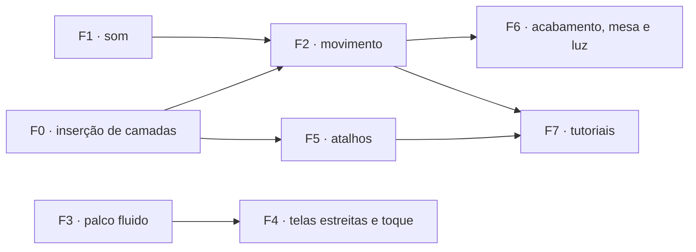

# Plano · Qualidade de vida, fluidez, ambientação e responsividade do Ateliê

Escrito em 25/10/2026, com as etapas 1 a 27 e a 29 concluídas (a 28 é no Tabletop). Segue as regras de `docs/plano/00-LEIA-PRIMEIRO.md`: uma fase por vez, cada uma é um commit com teste, e o `progress.md` é atualizado. Toda fase com interface segue o `PLANO-INTERFACE.md`.

## O que o levantamento achou

| Achado | Onde | Tipo |
|---|---|---|
| **Um asset adicionado da biblioteca vai para o fundo da pilha.** O motivo é um bug, não falta de recurso: `addLayer(handout, layer, index)` recebe o **id** da camada selecionada, e não a posição dela. `Math.min(len, 'abc')` dá `NaN`, e `splice(NaN)` insere na posição 0. Sem nada selecionado, `null` vira 0, e o asset também vai para o fundo. | [editor.js:1174](file:///home/ilvro/Documents/Projects/Atelie/src/editor/editor.js#L1174), [library-panel.js:176](file:///home/ilvro/Documents/Projects/Atelie/src/editor/library-panel.js#L176) e [:229](file:///home/ilvro/Documents/Projects/Atelie/src/editor/library-panel.js#L229) | bug |
| **Arraste em meia resolução** (§7 do PLANO-INTERFACE: "arrastar a 60 qps; renderize a meia resolução e refaça ao soltar") não existe. Cada `pointermove` refaz o documento inteiro em resolução total. | `stage.js` `performRender` | prometido, não feito |
| **Telas estreitas** (§5: "< 1100 px o inspetor vira gaveta; < 720 px só Preencher e Leitura") não existem. Nenhum `@media (max-width…)` no CSS. | `src/ui/*.css` | prometido, não feito |
| **Movimento da §4**: só o carimbo ARQUIVADO, o brilho UV, o levantar da miniatura e a troca na Leitura existem. Faltam a folha entrando ao abrir, a troca de documento no editor e o aviso caindo com rotação. | `styles.css`, `editor.css` | prometido, em parte |
| **Ambientação da mesa e iluminação**: o palco do editor (`.stage-viewport`) usa fundos escuros genéricos sem a textura tátil de bancada prometida. Não há textura de cortiça investigativa, e falta um controle rápido de iluminação (luminária, vela, lanterna de inspeção móvel, luz de estúdio) para testar os documentos em diferentes climas de mesa de jogo. | `stage.js`, `settings.js`, `primitives.css` | novo |
| Não há nenhum som no app. | — | novo |
| O plano de tutoriais de outra conversa (`plano-tutoriais-interativos.md`) usa um modelo de dados que não existe (`handout.pages`, `layer.type`, `state.uvLampActive`) e controles inventados ("Camada Oculta (Luz UV)", margens de corte, preset A5, máscara de borda rasgada). Ele também não traz as lições do `PLANO_TUTORIAIS.md` do Tabletop: passos "agora sozinho", ajuda em degraus, o retorno "quase lá" e o "?" em cada tarefa. | brain de outra conversa | corrigir |

> [!IMPORTANT]
> A Fase 0 é curta e corrige o que o usuário mais sente. Vale fazê-la antes de qualquer outra coisa.

---

## Fase 0 · Camadas entram onde se espera

**Regra de inserção** (uma função pura nova em `src/domain/handouts.js`, usada em **todos** os pontos que criam camada: biblioteca, colar, arrastar arquivo, menu "+", efeitos, texto, forma):

```js
/** Where a new layer goes: papers at the bottom; anything else right above the selection, or on top when nothing is selected. */
export function insertionIndex(handout, layer, { selectedId = null, role = 'auto' } = {})
```

- `role: 'paper'` (itens da categoria Papéis e `defaults.cover`) vai para cima da camada de papel mais alta que já existir. Assim, trocar de papel não esconde nada.
- Os outros vão logo acima da camada selecionada. Sem seleção, vão para o **topo**.
- `addLayer` passa a aceitar **apenas** número e a lançar erro se receber outra coisa. O bug não volta calado.
- Depois de inserir: a camada fica selecionada, a lista de camadas rola até ela e a linha pisca uma vez (`--eco-mid`).

Testes:
- unidade: `insertionIndex` para papel, sangue com e sem seleção, e `addLayer` rejeitando string;
- E2E: arrastar "Sangue · gotas múltiplas" para um modelo com 10 camadas deixa a camada nova em `layers.at(-1)` e à vista no pixel.

---

## Fase 1 · Sons da bancada (desligáveis)

**`src/ui/sound.js`**: sons **sintetizados com Web Audio**, sem arquivo nenhum. Ruído filtrado, envelopes curtos e uma pequena variação aleatória de altura e volume a cada toque, para não soar repetitivo. Isso dá zero bytes e nenhuma licença a registrar. Se um som sintetizado não convencer, a alternativa é um `.ogg` CC0 em `public/colecao/sons/`, registrado em `docs/LICENCAS.md`.

| Momento | Som |
|---|---|
| Digitar numa camada de texto (edição no lugar e campo de texto do Preencher) | depende da fonte: **Máquina de escrever**: tecla, espaço mais grave, sininho e carro no Enter; **Letra à mão / Marcador**: risco de lápis curto; **Tela de computador**: clique de teclado e bipe baixo no Enter; as outras: tecla macia |
| Soltar um carimbo, selo ou lacre na página | batida seca (o lacre ganha um "chiado" de cera) |
| Fita crepe | fita rasgando |
| Abrir ou trocar documento, virar o verso | papel deslizando |
| Ligar e desligar a luz UV | clique de interruptor e zumbido baixo enquanto está ligada (só se "Ambiente" estiver ligado) |
| Alternar iluminação (luminária / lanterna / vela) | clique mecânico de botão, click de lanterna de metal ou fósforo acendendo |
| Arquivar | carimbo ARQUIVADO |
| Excluir camada / desfazer | amassar curto / sem som |

Regras:
- O contexto de áudio só é criado depois do primeiro gesto da pessoa (a política dos navegadores exige isso).
- O som fica mudo com a aba escondida, e as teclas são limitadas a no máximo 1 som a cada 35 ms, para que segurar uma tecla não vire metralhadora.
- Tudo passa por `play(name, { variant })`. O editor não sabe sintetizar nada.

**Ajustes da Mesa → Som**:
- `sound: { enabled, volume (0–100), typing: 'auto' | 'typewriter' | 'pen' | 'off', ambient }`;
- uma linha "Ouvir exemplo" ao lado de cada opção.

Testes:
- unidade: mapear fonte → voz de digitação; limitar os toques; `enabled: false` não cria `AudioContext`;
- E2E: com o som ligado, digitar 5 letras chama `play('type')` 5 vezes (espião em `window.__atelie.sound`); com ele desligado, nenhuma vez.

---

## Fase 2 · Movimento e retorno visual

Só `transform` e `opacity`, os tokens `--eco-*` e nada com `prefers-reduced-motion` ou `body.reduce-motion`.

1. **Completar a §4:**
   - a folha entra de baixo 24 px, girada 2°, ao abrir;
   - ao trocar de documento, ela sai pela esquerda e a nova entra pela direita;
   - o aviso cai do canto com rotação.
2. **Camada nova "pousa" na página:** um contorno aparece por cima da camada em escala 1,06 → 1, com a sombra baixando (`--eco-fast`). Em seguida vem o som da Fase 1.
3. **Lista de camadas com FLIP:** reordenar, subir, descer, agrupar e excluir animam a posição das linhas em vez de saltar.
4. **Excluir com desfazer à mão:** o aviso "Camada excluída · **Desfazer**" fica 5 s na tela. O mesmo vale para "Documento movido para a lixeira".
5. **Arrastar da biblioteca:** um "fantasma" semitransparente do item segue o cursor sobre a página, já no tamanho e na mesclagem que vai ter (`defaultsFor`). A pessoa vê onde vai cair antes de soltar.
6. **Gavetas e inspetor:** abrir e fechar com deslizamento, e trocar de aba com um cruzamento curto de opacidade.
7. **Sliders e números:** a roda do mouse sobre o campo ajusta o valor (Shift dá passo ×10), e o valor aparece num balão durante o arraste.

Teste E2E: com redução de movimento ligada, nenhuma animação passa de 0 ms (o mesmo `getAnimations()` usado em `shell.test.js`).

---

## Fase 3 · Palco fluido (desempenho)

Metas da §7, medidas por teste: abrir um A4 com 15 camadas em menos de 400 ms; arrastar a 60 quadros por segundo.

1. **Três camadas de cache durante o arraste:** ao começar a mover a camada *k*, componha uma vez o "abaixo de *k*" e o "acima de *k*" em bitmaps. Cada quadro passa a desenhar só 3 coisas. Ao soltar, refaça o documento inteiro.

   > [!NOTE]
   > Uma camada com mesclagem não normal acima de *k* depende do que está embaixo. Nesse caso o cache de "acima" não vale, e o arraste cai para o item 2.

2. **Meia resolução no arraste** (e no zoom com a roda), refeita em resolução total 150 ms depois do último movimento.
3. **Cache dos efeitos procedurais** por `(tipo, parâmetros, semente, tamanho)`: ruído e desgaste não são recalculados a cada quadro.
4. **Layout de texto memorizado** por `(conteúdo, fonte, caixa)`: mexer na posição não refaz a quebra de linhas.
5. **Assar e exportar fora da thread principal** com `OffscreenCanvas` num Worker, quando o navegador permitir (com recuo para a thread principal). Arquivar não trava mais a interface.

Testes:
- `tests/e2e/perf.test.js` mede abrir o A4 de 15 camadas e 60 eventos de arraste, com o tempo médio por quadro abaixo de 16,7 ms numa máquina de referência; os números vão para o `progress.md`;
- um teste de pixel confere que o resultado final depois de soltar é **idêntico** ao render normal.

---

## Fase 4 · Telas estreitas e toque

Cumpre a §5:
- **< 1100 px:** o inspetor vira gaveta pela direita, com botão na barra do documento.
- **< 720 px:** a tela de início, o **Preencher** e a **Leitura** ficam completos; o editor mostra só "Propriedades simples" (texto, fonte, cor, posição).
- **Toque** (`pointer: coarse`):
  - pinça para zoom e dois dedos para mover a mesa;
  - alças de transformação de 24 px;
  - pressionar longo abre o menu de contexto.
- **Container queries** nos painéis do inspetor: os controles se reorganizam pela largura do painel, não da janela.

Teste E2E em 3 viewports (1600 × 950, 1024 × 768, 390 × 844): nada sobra para fora da tela (`scrollWidth ≤ clientWidth`); Preencher e Leitura funcionam a 390 px. As capturas de referência vão para `docs/referencias/`.

---

## Fase 5 · Atalhos de quem edita muito

Cada item é pequeno e independente:

- **Alt+clique** alterna entre as camadas empilhadas sob o cursor. Hoje só a de cima é alcançável pelo palco.
- **Variação ao duplicar** (Ctrl+Shift+D): cópia com deslocamento, rotação de ±4° e, em efeitos, semente nova. Serve para três gotas de sangue que não sejam idênticas.
- **Carimbos entram tortos:** ao soltar um carimbo ou selo, ele recebe uma rotação de ±3° (desligável nos Ajustes). Carimbo reto parece digital.
- **Lembrar a última escolha:** um texto novo herda a fonte, a cor e o tamanho do último texto editado no documento.
- **"Usados recentemente"** como primeira fileira da Biblioteca (12 itens, em `localStorage`).
- **Mini-barra** sobre a seleção com Trazer para frente e Enviar para trás (Ctrl+] e Ctrl+[ já existem, mas ninguém os descobre) e a troca rápida de mesclagem.
- **Esc** em cascata: primeiro sai da edição de texto, depois tira a seleção, depois fecha a gaveta.
- **Clique duplo em área vazia da página** cria um texto ali.

Cada atalho novo entra em `src/ui/shortcuts.js`, e o teste da etapa 27 confere que alguém o trata.

---

## Fase 6 · Acabamento visual, superfícies da bancada e ambientação de luz

1. **Superfícies procedurais completas no palco da mesa:**
   - O palco do editor (`.stage-viewport` e `.stage-scroll-canvas`) passa a renderizar visivelmente a textura da bancada selecionada, em vez de fundos planos escuros.
   - **Nova textura: Cortiça Investigativa (`cortica`)**: granulação procedural clara/escura com relevo e furos sutis de alfinete (clássico de quadros de investigação policial e RPGs de mistério).
   - Aprimoramento das texturas existentes em `primitives.css` e `settings.js`: **Madeira escura envernizada**, **Feltro verde de alfaiate/jogos**, **Couro**, **Concreto / Ardósia forense** e **Preto neutro**.
   - As texturas são 100% procedurais (SVG inline / gradientes CSS), com zero carregamento de arquivos externos.

2. **Modos de Iluminação e Ambientação rápida:**
   - Adição de um botão rápido com menu de iluminação no topo do palco (ou atalho de teclado) para inspecionar o documento em diferentes climas:
     - **Luminária de Bancada** (padrão): foco central suave sobre o documento com calor ajustável (quente/neutro) e penumbra discreta na borda da mesa.
     - **À Luz de Velas (`vela`)**: luz âmbar/alaranjada quente com uma leve e sutil tremulação orgânica na vinheta da mesa (respeita `prefers-reduced-motion`).
     - **Lanterna Móvel de Inspeção (`lanterna`)**: o ambiente escurece e um feixe circular de lanterna segue a posição do cursor do mouse, permitindo inspecionar detalhes, desgastes e caligrafias minuciosas (`Shift + roda` ajusta a abertura do feixe).
     - **Luz Negra / UV (`uv`)**: integra a iluminação UV da Etapa 19, escurecendo a sala em tom violeta profundo e ativando o brilho das tintas fluorescentes e marcas d'água.
     - **Luz Plana de Estúdio (`estudio`)**: iluminação clara, uniforme e sem sombras na mesa, ideal para alinhamento geométrico e conferência de contraste estrito.

3. **Sombra e profundidade da folha:**
   - Sombra projetada da folha proporcional ao zoom e responsiva à direção e ao modo de luz ativo.
   - Leve reflexo da luminária sobre a mesa na direção do documento.

4. **Acabamentos de interface:**
   - **Miniatura real na linha da camada** (render da camada sozinha, 40 px, em cache por revisão), no lugar do ícone genérico por tipo.
   - **Esqueleto de carregamento** na Biblioteca e nos Modelos (retângulos de papel pulsando de leve), em vez de a área aparecer vazia.
   - **Estados vazios** com ilustração (§7) onde ainda faltam: busca sem resultado, pasta vazia, documento sem camadas além do papel.
   - Revisão de contraste dos selos e carimbos de interface sob a luz UV.

---

## Fase 7 · Tutoriais interativos (substitui o plano da outra conversa)

**O motor** é cópia adaptada de `../Tabletop/src/tutorial/` (`tutor.js`, `conditions.js`, `lessons.js`), com as melhorias que o `PLANO_TUTORIAIS.md` do Tabletop pede e que o motor de lá ainda não tem. É cópia, com o teste junto, sem importar código do Tabletop:

- **Documento de treino:** a lição abre um documento temporário. O documento da pessoa fica como estava (o rascunho é gravado antes), e o E2E confere isso.
- **Só aponta, não faz:** um anel no controle e o cartão com o passo, e o passo avança quando a condição sobre o estado real fica verdadeira.
- **Ajuda em degraus:** aos 20 s o anel insiste; aos 35 s o cartão oferece "Mostrar onde" e "Mostrar o valor".
- **Passos `try` ("Agora sozinho")**, sem anel, para conferir se a pessoa aprendeu.
- **"Quase lá"** em medidas contínuas: "opacidade 60 de 85", "falta girar 4°".
- **"?" nas tarefas:** dicas de um minuto abertas do próprio painel (ex.: o "?" ao lado de "Luz" nas propriedades abre "Esconder um texto sob UV").

**Condições sobre o modelo real** (`handout.layers`, `layer.kind`, `layer.light`, `layer.blend`, `editor.light`):

```js
layerFrom(state, { library: 'casa-…' })      // existe camada vinda deste item
layerWhere(state, { kind: 'text', 'text.font.library': … })
selected(state, predicate)                   // a camada selecionada satisfaz
uvOn(state)                                  // editor.light === 'uv'
archived(state)                              // revisão > 0 e sem rascunho
```

**Lições** (nomes reais da coleção):

| Pasta | Lição | Passos principais |
|---|---|---|
| Primeiros passos | **Preencher um modelo** (3 min) | abrir "Carta envelhecida", Preencher, trocar a data e a assinatura, Arquivar |
| Primeiros passos | **Uma carta de 1890** (8 min) | folha em branco A4, papel "Ofício creme (Antigo)", texto em "Libre Baskerville Italic", cor sépia, "Mancha de café · anel" (repare: entra em Multiplicação), "Dobras · carta em três", *agora sozinho: um "Lacre de cera · vermelho (com brasão)"* |
| Primeiros passos | **Bilhete rasgado** (5 min) | modelo "Bilhete de caderno rasgado", girar o texto a −2,5°, "Fita crepe · diagonal" no canto, "Rasgo · canto arrancado" |
| Investigação | **Ficha criminal** (8 min) | modelo "Ficha criminal", enviar uma foto, ajuste de dessaturação recortado na foto, "Prendedor · clipe prateado (inclinado)", "Carimbo · Confidencial" a 85 %, tarja preta (forma) sobre um nome |
| Segredos | **Tinta invisível** (6 min) | texto novo, Luz UV ligada (camadas novas entram como UV), escrever o segredo, desligar e ver sumir, "Escurecer sob UV" na página, *agora sozinho: mude uma camada existente para "só UV"* |
| Segredos | **Ler como os jogadores** (3 min) | Modo Leitura, lupa (L), lanterna UV, virar o verso |
| Produção | **Imprimir e levar à mesa** (4 min) | Exportar PNG 300 ppp, imprimir em tamanho real, e (com a etapa 28 feita) enviar ao Tabletop |

Pontos de entrada: a gaveta de **Ajuda** (seção "Aprender na prática"), o cartão "Aprender o básico" na tela de início, o Ctrl+K e o "?" nas tarefas.

Testes: `tests/e2e/tutorials.test.js` percorre **toda** lição até o fim e confere que o documento anterior da pessoa voltou intacto. Um relatório de cobertura lista os `data-action` que nenhuma lição ou dica usa.

---

## Ordem e dependências



F0 é o primeiro (bug visível). F1 e F3 podem andar em paralelo. F7 por último, porque os tutoriais ensinam a interface final: escrever lições antes de F2 e F5 obrigaria a reescrevê-las.

## Riscos

- **Som que irrita:** o padrão proposto é **desligado** na primeira visita, com um bilhete de boas-vindas oferecendo ligar ("A bancada tem som. Ligar?"). Assim a pessoa escolhe sem ser surpreendida.
- **Cache do palco com mesclagens:** se o cache de "acima" for usado com mesclagem não normal, o resultado fica errado sem ninguém notar. O teste de pixel "depois de soltar = render normal" pega isso.
- **Arquivos compartilhados:** `editor.js`, `stage.js` e `layers-panel.js` são grandes e mudaram muito no último dia. Cada fase mexe neles; é preciso commitar uma fase antes de começar a outra.
- **Desempenho com iluminação dinâmica (lanterna / vela):** a vinheta e o feixe de luz que segue o cursor devem ser implementados via CSS (`mix-blend-mode` / `radial-gradient` acelerado por GPU em camadas flutuantes sem refazer o canvas de renderização do documento).
- **Etapa 28 (Tabletop):** a lição "Imprimir e levar à mesa" só ganha o último passo quando a 28 existir. Até lá, o passo fica oculto.

## Como validar o conjunto

- Arrastar qualquer elemento da biblioteca põe a camada visível por cima, sem nenhum clique a mais.
- Arrastar uma camada num modelo de 30 camadas não engasga (medido pelo teste de desempenho).
- O Preencher e a Leitura funcionam num celular de 390 px.
- Trocar para cortiça, madeira ou feltro altera o palco da mesa de forma nítida e responsiva.
- A alternância entre luminária, vela, lanterna de inspeção e luz UV funciona suavemente no palco com resposta tátil e sonora.
- Uma pessoa que nunca usou o Ateliê faz "Uma carta de 1890" sozinha e depois repete sem o tutorial.
- Com som e animações desligados, nada da interface depende deles para ser entendido.

